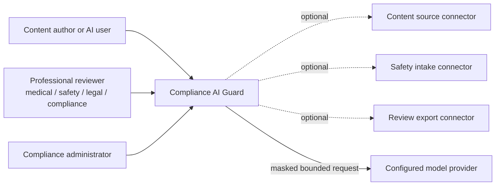
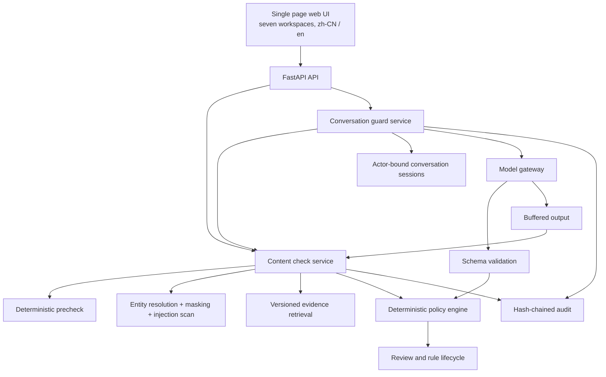
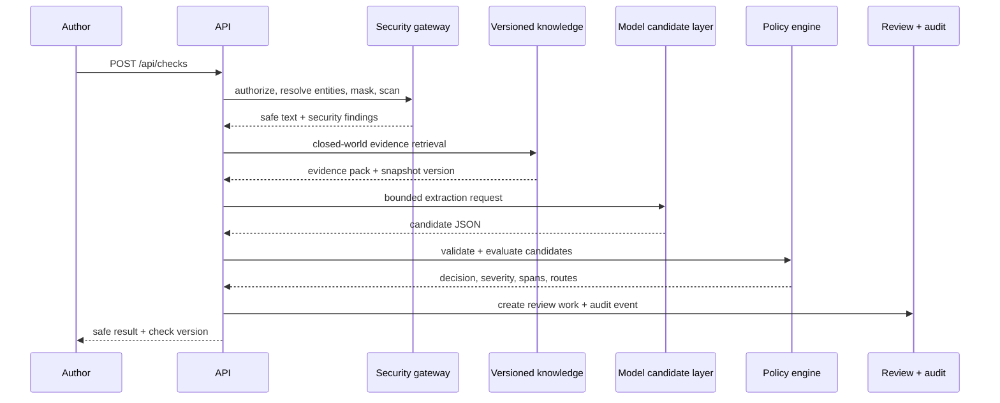
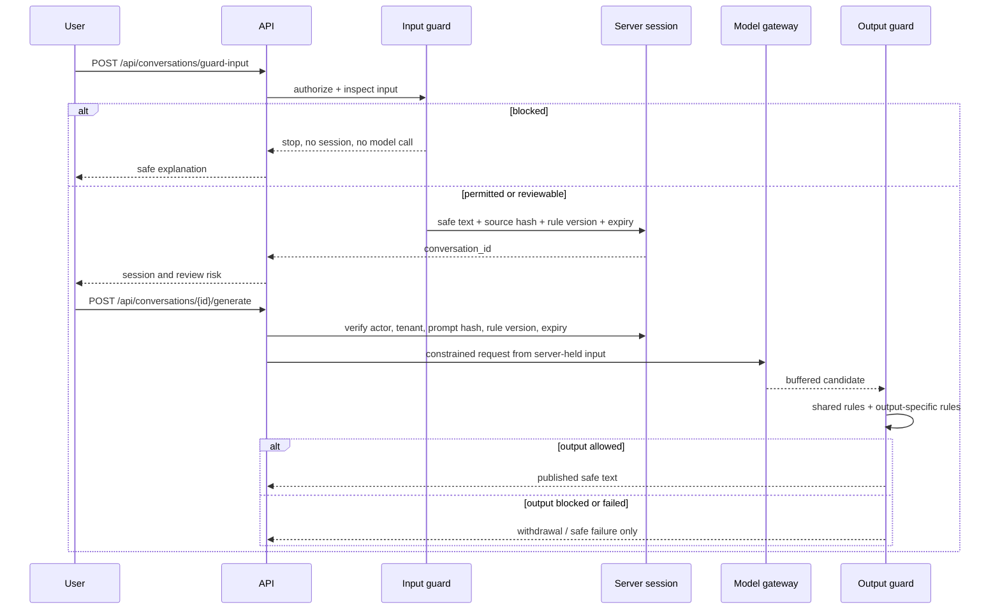
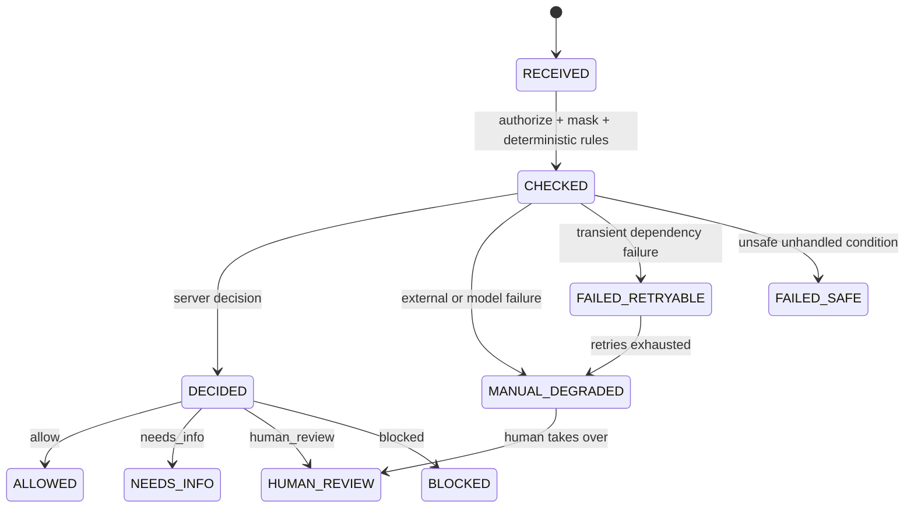

# Architecture

**English** · [简体中文](zh/architecture.md)

## 1. Product boundary

Compliance AI Guard is a standalone control service for medical content and AI
conversations. It accepts content directly, or receives it through optional
provider-neutral connectors. It does not require a particular customer system,
business object model, vendor SDK, database, queue, identity provider, or online
model.

Two public entry points share one control plane:

- `POST /api/checks` checks text before save, send, or release.
- `POST /api/conversations/guard-input` checks untrusted AI input before a
  generation session exists.

The content and conversation paths share the rule bundle, policy engine, finding
schema, review queue, rule lifecycle, and audit chain. A rule update therefore
cannot create two different meanings for the same risk.

## 2. Core decision: workflow-first, model-as-candidate

The model may read language, extract structured fields, propose findings, and draft
a response. It cannot set the final decision, severity, approval status, review
routing, release permission, or tool permissions.

| Concern | Owner | Why |
| --- | --- | --- |
| Language understanding and bounded extraction | Model candidate layer | Useful probabilistic capability |
| Decision, severity, routing, permissions | Deterministic policy engine | Reproducible and reviewable |
| Input, generation, and output transitions | Server workflow code | Must not fail open |
| Evidence admissibility and versions | Retrieval layer | Must be filtered and replayable |
| Release after human review | Review and audit services | Must be attributable |

The rejected alternative is an autonomous loop that chooses its own tools and final
release verdict. In a compliance path, the sequence of controls is part of the
control itself. See [decisions/0001-workflow-first-controlled-agent.md](decisions/0001-workflow-first-controlled-agent.md).

## 3. System context



The dashed connector paths are contracts, not required services. Standalone mode
keeps everything local. Every optional connector declares its data class, permitted
actions, version behavior, and health state. See
[integration-contracts.md](integration-contracts.md).

## 4. Containers



The model gateway has no edge to release permission. Candidate output goes through
schema validation and server policy evaluation. Conversation output goes back
through the same content-check path before it can be displayed.

## 5. Content check path



The edit-time precheck is shorter: `POST /api/checks/precheck` performs masked,
deterministic checks without creating a case or invoking a model.

Two orderings are load-bearing:

1. Entity resolution runs before masking so one person resolves to one token.
2. Prompt-injection scanning runs before model access.

## 6. AI conversation: input, generation, output



The generation request must carry the exact text already checked. A content hash
mismatch returns `conversation_prompt_mismatch`; a rule-version change returns
`conversation_requires_recheck`; an expired or closed session returns
`conversation_expired`. These checks prevent a client from turning an old success
flag into permission for a different prompt.

The response is buffered. A blocked output is not echoed back with a warning. It is
withdrawn, and the server returns only safe findings and state. Any generation or
output-check exception becomes `failed_safe` with no published text.

## 7. Decisions, severity, and actions

Four public decisions are used: `allow`, `needs_info`, `human_review`, `blocked`.
`refused` is an internal terminal value for unsafe requests that cannot be
processed safely.

| Severity | Meaning |
| --- | --- |
| **S0** | Redline. Security or safety condition requiring immediate escalation or block |
| **S1** | High risk requiring professional review |
| **S2** | Missing information or context; re-run after completion |
| **S3** | Low-risk wording or format guidance |

Each finding carries `allow_save`, `allow_generate`, and `allow_publish`. A
conversation input can exist only if it is not blocked and every finding allows
generation. Output is published only when the aggregate decision is `allow` and
every finding allows publication. S0 and S1 findings cannot be self-approved.

## 8. Shared policy rules

The shipped bundle is `config/policies/general-medical-demo.json`, version
`GENERAL-MEDICAL-2026-01`. It contains 21 rules. Rules carry content types, entry
scope, patterns or derived conditions, severity, decision, required roles, SLA,
remediation, evidence requirements, and span requirements.

| Rule | Finding | Severity | Decision | Routed to | SLA |
| --- | --- | --- | --- | --- | --- |
| CN-001 | `potential_adverse_event` | S1 | human_review | safety + medical | 8h |
| CN-002 | `serious_adverse_event` | S0 | human_review | safety + medical | 4h |
| CN-003 | `bribery_or_inducement` | S1 | blocked | compliance + legal | 8h |
| CN-004 | `comparative_claim` | S1 | human_review | compliance + medical | 8h |
| CN-005 | `prompt_injection` | S0 | blocked | compliance admin | immediate |
| CN-006 | `pii` | S1 | human_review | compliance admin | 8h |
| CN-007 | `phi` | S1 | human_review | compliance admin | 8h |
| CN-008 | `severe_pii_leak` | S0 | blocked | compliance admin | immediate |
| CN-009 | `off_label` | S1 | human_review | compliance + medical | 8h |
| CN-010 | `evidence_conflict` | S1 | human_review | compliance + medical | 8h |
| CN-011 | `expired_evidence` | S1 | human_review | submitter + medical | 24h |
| CN-012 | `missing_evidence` | S2 | needs_info | submitter + medical | 24h |
| CN-013 | `missing_context` | S2 | needs_info | reviewer | 24h |
| CN-014 | `permission_failure` | S1 | blocked | compliance admin | 8h |
| CN-015 | `irreversible_write` | S0 | blocked | compliance admin | immediate |
| CN-016 | `security_issue` | S1 | blocked | compliance admin | 8h |
| CN-017 | `unapproved_promotion` | S0 | blocked | compliance + legal | 4h |
| CN-018 | `formatting` | S3 | allow | reviewer | 72h |
| CN-019 | `ambiguous_entity` | S2 | needs_info | reviewer | 24h |
| CN-020 | `claim_discrepancy` | S1 | human_review | compliance + medical | 8h |
| CN-021 | `unresolved_indication` | S2 | needs_info | medical | 24h |

A bundle outside its effective window is refused at startup. Rules are drafted,
tested, evaluated, published, and rolled back as immutable versions. A historical
result keeps the policy version that produced it.

## 9. Content model and spans

A check request carries `tenant_id`, `content_type`, optional subtype, market,
language, optional product and therapeutic area, source text or content parts,
optional structured fields, requested rule version, retention policy, external
reference, and client content version.

`content_type` is generic: customer interaction note, medical information request,
medical field note, promotional content, AI conversation, or other. The external
reference is for caller correlation and does not affect the decision.

Findings use Unicode character offsets against the exact submitted version.
If the client's text hash differs from the server result version, spans are
reported as stale and the UI requires another check. If a rule cannot produce a
reliable span, it keeps the finding and leaves the span empty. It never searches a
similar phrase and presents a guessed highlight as evidence.

## 10. Evidence and off-label comparison

A full product label is not sent as a request payload. Labels are structured into
versioned facts at ingestion. The model may extract indication, population, line,
dose, route, duration, and combination as candidates. Server code compares each
field against the evidence snapshot.

Indication matches by concept id first, falling back to text only when no id is
present. A mismatch records the exact `label_field:<name>` and produces CN-009.
Retrieval is filtered by tenant, market, product, language, status, effective
window, and access scope. No evidence becomes CN-012, never an allow.

## 11. Masking that preserves meaning

Under-masking leaks an identifier. Over-masking damages narrative and can remove a
safety keyword before the rule engine reads it. Both are release gates.

- Person names are detected using the configured dictionary and only the matched
  name span is replaced.
- Entity resolution runs before masking so aliases receive one stable token.
- Two plausible people are not silently merged; ambiguity becomes a follow-up.
- The masking component is local and deterministic.
- Masking recall and source fidelity both have a 1.0 floor.

## 12. Model gateway and routing

Task routes are selected from configured capabilities, region, data class, and
publication state. Profiles store an opaque credential reference; the actual
credential stays in the environment or a gitignored secret file. The audit trail
records `model_profile_id` for stable business routing and `model_upstream` for the
provider model that answered.

Draft validation rejects plaintext secrets, literal endpoints, incomplete
capability declarations, and incompatible region or data-class combinations.
Publishing creates an immutable `v{n}` snapshot. Rollback restores a prior stable
snapshot. Both operations require an administrator role and are audited.

## 13. Failure states



**Invariant: no failed or degraded state can transition to `ALLOWED`.** Input
failure means no generation. Output failure means no publication. Audit failure
means release fails. Model or connector outage routes work to a person.
`FAILED_SAFE`, `FAILED_RETRYABLE`, and `MANUAL_DEGRADED` remain visible states.

## 14. Review, rules, and audit

Review tasks are created by required role and rule finding. Queue filtering does
not remove the underlying decision, finding, task, or audit event. `scope=all`
keeps technical work visible. Review decisions include a signature manifestation
bound to the signed content; S0 and S1 cannot be self-approved.

The quality and audit workspace combines hash-chain verification, oversight
metrics, candidate regression cases, connector inventory, and the append-only
event view. Every ledger entry carries `sha256(prev_hash + canonical body)`.
`GET /api/audit-trail/verify` identifies the first position that cannot be trusted.
Audit payloads use digests, identifiers, versions, and aggregates; original content
and token maps are excluded.

## 15. UI information architecture

The single-page interface has seven workspaces in this order:

| Workspace | Role |
| --- | --- |
| `overview` | context, status, and shortcuts |
| `content_check` | arbitrary content submission |
| `conversation_guard` | input, generation, output states |
| `reviews` | professional work queue |
| `rules` | rule inspection and controlled lifecycle |
| `quality_audit` | audit and quality evidence |
| `settings` | model profiles, routes, and versions |

The server returns the capability matrix. Client-side hiding improves usability,
but every endpoint independently re-checks permission. Language changes preserve
drafts and UI state. Machine codes remain visible beside human-readable labels.

## 16. Repository layout

```text
apps/api/          FastAPI application and route handlers
src/compliance_guard/
  agents/          bounded model-facing extraction and generation steps
  audit/           hash chain, traces, metrics, signature manifestations
  domain/          shared enums, requests, responses, and findings
  integrations/    optional source, safety, and export contracts
  knowledge/       label facts, retrieval, evidence packs, indication mapping
  llm/             model gateway, profiles, routes, mock and live adapters
  policy/          rule schema, engine, precedence, bundles, routing
  review/          review queue, decisions, lifecycle, feedback
  security/        entity resolution, masking, injection scan, authorization
  workflow/        content checks, conversation guard, precheck, orchestration
  web/             seven-workspace bilingual interface
config/            policy bundles, prompts, model profiles, routes, glossary
data/              synthetic fixtures, golden set, mock responses
tests/             unit, contract, integration, security, evaluation
```
