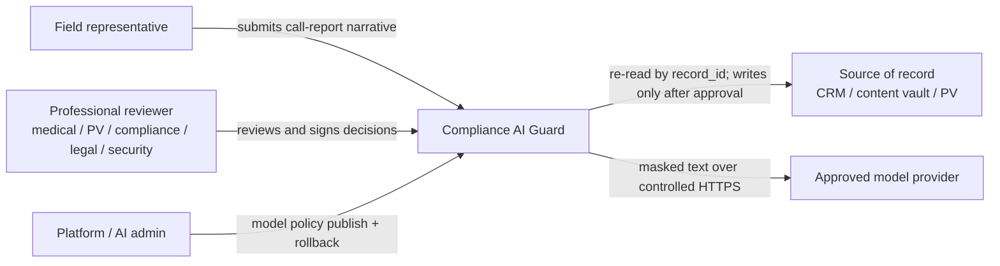
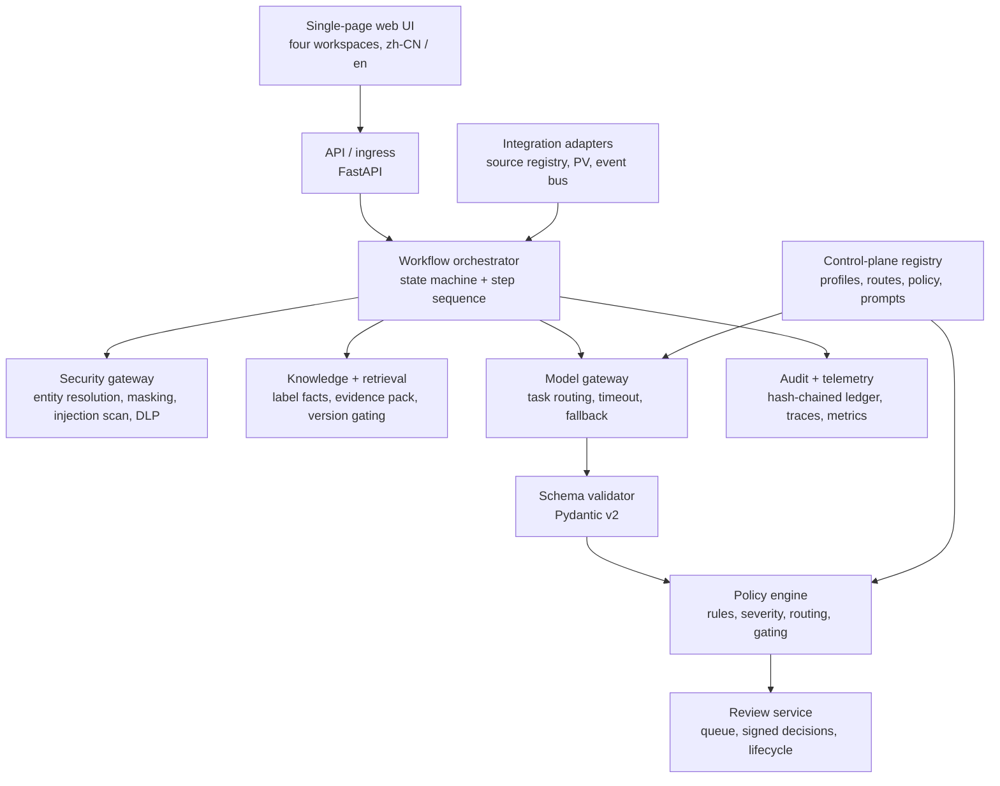
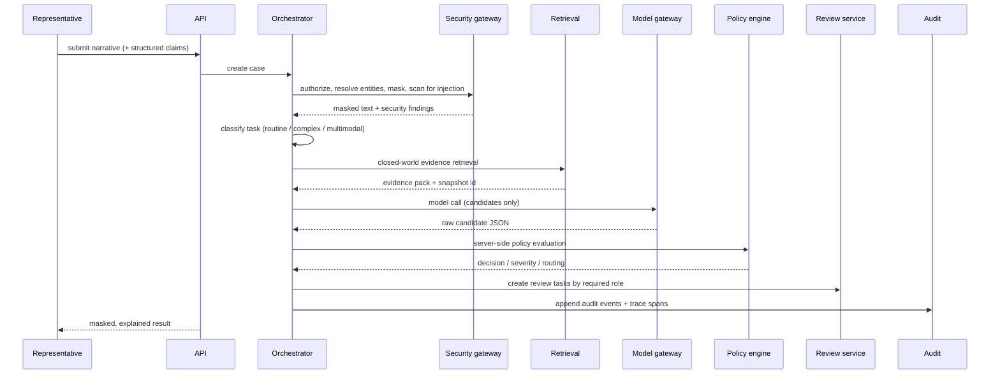
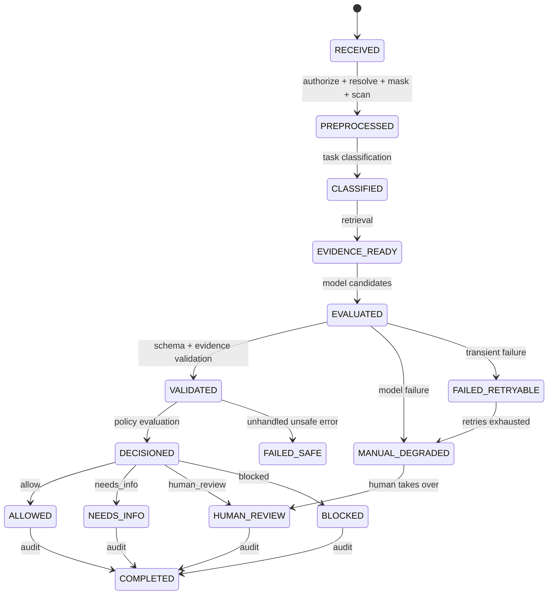

# Architecture

**English** · [简体中文](zh/architecture.md)

## 1. The core decision: workflow-first, model-as-candidate

The model never decides. It reads Chinese free text and returns structured
candidates; the server decides.

Everything that carries consequence — decision, severity, review routing,
approval status, tool permissions — is produced by a deterministic policy engine
and a code-controlled state machine. That split is the whole design, and it is
why a case can be replayed, audited, and explained without asking a model what
it was thinking.

| Concern | Owner | Why |
| --- | --- | --- |
| Understanding Chinese narrative, extracting label fields | Model | The task language models are good at |
| Decision, severity, routing, permissions | Policy engine (code) | Must be reproducible and reviewable |
| State transitions, failure handling | State machine (code) | Must never fail open |
| Evidence admissibility, versioning | Retrieval layer (code) | Must be version-gated and filterable |

The alternative — an autonomous agent choosing its own steps, tools, and release
verdict — was rejected. In a compliance path the sequence of steps *is* the
control, and an open loop cannot be validated, replayed, or explained to a
reviewer. See [decisions/0001-workflow-first-controlled-agent.md](decisions/0001-workflow-first-controlled-agent.md).

## 2. System context



The source-of-record and PV boundaries are implemented as **contract-only
adapters**. They exercise the invariants a live integration needs (re-read,
version rejection, approval-gated writes, idempotency) without contacting any
real system. See [integration-contracts.md](integration-contracts.md).

## 3. Containers



Note the direction of the arrows around the model: the gateway returns candidates
to the **validator**, which hands validated candidates to the **policy engine**.
The model has no edge into the decision.

## 4. Request path



Two orderings are load-bearing. Entity resolution runs **before** masking, so one
person becomes one token. The injection scan runs **before** the model call, so a
hostile instruction never reaches the model at all.

## 5. States and failure paths



**Invariant: a case can never reach `ALLOWED` from a failed or degraded state.**
Every configured route ships `requires_human_on_failure: true`, so every
model-failure category — timeout, schema violation, connection error — lands in
`MANUAL_DEGRADED` with a human review task, never in a silent allow.

`FAILED_SAFE` is reached by unhandled unsafe errors and explicit fail-safe
events. It would also be reached by a model failure in the
`audit`/`permission`/`policy`/`schema` categories if a route disabled
`requires_human_on_failure` — the ladder is implemented, not just described.

## 6. Decisions and severity

Four decisions: `allow`, `needs_info`, `human_review`, `blocked` (plus `refused`
for unsafe errors).

| Severity | Meaning |
| --- | --- |
| **S0** | Redline. Serious AE, data leak, injection: blocked or escalated immediately, never self-approved |
| **S1** | High risk. Requires professional review (PV / medical / compliance / security) |
| **S2** | Needs info. Insufficient evidence or context; re-run once supplied |
| **S3** | Low risk. Wording or formatting guidance only |

S0 and S1 cannot be self-approved; the reviewer's *accept* option is disabled for
both.

## 7. Policy rules

21 rules in `config/policies/cn-demo.json`, versioned `CN-COMPLIANCE-2026-01`.
Each carries patterns, severity, decision, required roles, SLA, and whether an
evidence gap is acceptable.

| Rule | Finding | Sev | Decision | Routed to | SLA |
| --- | --- | --- | --- | --- | --- |
| CN-001 | `potential_adverse_event` | S1 | human_review | PV + medical | 8h |
| CN-002 | `serious_adverse_event` | S0 | human_review | PV + medical | 4h |
| CN-003 | `bribery_or_inducement` | S1 | blocked | compliance + legal | 8h |
| CN-004 | `comparative_claim` | S1 | human_review | compliance + medical | 8h |
| CN-005 | `prompt_injection` | S0 | blocked | security | immediate |
| CN-006 | `pii` | S1 | human_review | security | 8h |
| CN-007 | `phi` | S1 | human_review | security | 8h |
| CN-008 | `severe_pii_leak` | S0 | blocked | security | immediate |
| CN-009 | `off_label` | S1 | human_review | compliance + medical | 8h |
| CN-010 | `evidence_conflict` | S1 | human_review | compliance + medical | 8h |
| CN-011 | `expired_evidence` | S1 | human_review | rep + medical | 24h |
| CN-012 | `missing_evidence` | S2 | needs_info | rep + medical | 24h |
| CN-013 | `missing_context` | S2 | needs_info | reviewer | 24h |
| CN-014 | `permission_failure` | S1 | blocked | security | 8h |
| CN-015 | `irreversible_write` | S0 | blocked | admin | immediate |
| CN-016 | `security_issue` | S1 | blocked | security | 8h |
| CN-017 | `unapproved_promotion` | S0 | blocked | compliance + legal | 4h |
| CN-018 | `formatting` | S3 | allow | reviewer | 72h |
| CN-019 | `ambiguous_entity` | S2 | needs_info | reviewer | 24h |
| CN-020 | `claim_discrepancy` | S1 | human_review | compliance + medical | 8h |
| CN-021 | `unresolved_indication` | S2 | needs_info | medical | 24h |

A policy bundle past its `effective_until` is refused at startup rather than left
quietly deciding cases.

## 8. Off-label detection: field comparison, not a model opinion

Asking a model "is this off-label?" fails three ways: a full Chinese label is
tens of thousands of characters and does not fit a request budget; irrelevant
label prose (placebo-arm side effects, for instance) pollutes the judgement; and
the answer cannot be checked against anything.

So the work is split:

1. **Labels are structured at ingestion**, not read at runtime — stored as label
   facts keyed by product, market, language, and version
   (`knowledge/label_facts.py`).
2. **The model extracts seven fixed fields**: indication, population, line of
   therapy, dose, route, duration, combination. It is never asked for a verdict.
3. **The server compares field by field** (`compare_label_fields`). Indication
   matches on concept id first, falling back to text only when no id is present,
   so "高血压" and "原发性高血压" are not a spurious mismatch.
4. **A mismatch produces CN-009** at S1 with the specific failing field recorded
   as `label_field:<name>`, so a reviewer sees which comparison failed.
5. **Retrieval is closed-world** — filtered by tenant, market, product, language,
   status, effective window, and access scope. No evidence found is an evidence
   gap (CN-012, `needs_info`), never an allow.

A local indication ontology maps colloquial phrasing ("血压高") to a concept id,
so what reaches the model is one product's structured facts rather than label
prose. Request size stays decoupled from catalogue size.

## 9. Masking that preserves meaning

Masking has two failure modes, and the dangerous one is not the obvious one.

**Under-masking** leaks an identifier. **Over-masking** deletes narrative — and
that is the subtle failure: an early regex-based implementation replaced its
whole match, so "赠送礼品给医生" lost the characters carrying "礼品" and the
bribery rule stopped firing. The case was still blocked, but by the PII rule
rather than the rule that described the actual problem. The same mechanism could
remove adverse-event keywords before the safety rules ran.

Current design:

- Person-name detection anchors on a surname dictionary (`config/surnames.json`)
  and replaces **the name span only**, so "患者" and "医生" survive.
- **Entity resolution runs before masking**, so 章三 / 章医生 / 章主任 resolve to
  one identity and one stable token. Two different people sharing a surname are
  flagged for confirmation rather than merged — misattributing a clinician's
  opinion is worse than asking one clarifying question.
- This is the one component that sees real names, so it is local and
  deterministic by design.

Both directions are measured as release gates: masking recall must be 1.0, and
**source fidelity** must be 1.0 (masking damaged nothing that was not an
identifier).

## 10. Client input is not fact

Structured form fields arrive as `claimed_fields`. The decision reads
`resolved_fields`, which the server derives from the narrative itself. A claim
that contradicts the text becomes a `claim_discrepancy` finding (CN-020) instead
of a silent bypass. Reserved keys (`decision`, `severity`, `approval_status`,
`routing`, `tool_permissions`) can never be set from intake.

## 11. Model gateway and routing

Three business profiles map to three task routes. Routing is deterministic and
validated on every call against capabilities, region, data class, and
published/enabled state; an incompatible route raises rather than guessing.

| Task route | Primary profile | Fallback | Data classes |
| --- | --- | --- | --- |
| `routine_compliance` | `deepseek-routine` | `kimi-complex` | pii_tokenized, confidential, internal, public |
| `complex_evidence_reasoning` | `kimi-complex` | none | internal, confidential, pii_tokenized |
| `multimodal_extraction` | `minimax-multimodal` | none | pii_tokenized, phi_tokenized |

Profiles hold an opaque `endpoint_ref`; the real upstream model id lives in
`config/endpoints/<profile>.json`, and credentials live outside the repository
entirely. This keeps the audit trail stable: `model_profile_id` records the
business routing name while `model_upstream` records the provider model that
actually answered, so repointing a profile never rewrites the meaning of a past
case.

Publishing is versioned: draft → validate → publish (`v{n}`) → rollback, gated on
admin permission and fully audited. Draft validation rejects plaintext secrets,
literal endpoints, and incompatible capability/region/data-class combinations
before anything is published.

## 12. Two-layer pre-check

Neither layer calls a model.

| Layer | Trigger | Runs in | Budget |
| --- | --- | --- | --- |
| **L0** local cues | every keystroke, 120 ms debounce | browser only, no request | instant |
| **L1** deterministic pre-check | 400 ms quiet, blur, or paste | `POST /api/cases/precheck` | p95 < 300 ms (measured ≈ 0.3 ms) |

Three deliberate properties: **L0 never says the content looks clean** (a local
word list cannot support "no problems found", and false reassurance teaches the
reader that silence means safety); **L1 creates no record** (no case, no stored
narrative, no audit entry — a draft is not a submission); and **L1 shares the
policy bundle with submission**, so a hint cannot contradict the final answer.
Evidence-completeness rules are excluded from L1 on purpose, because whether the
knowledge base holds a supporting record is a fact about retrieval, not about the
sentence being typed — showing it while writing produces a warning no amount of
editing can clear.

Drafts autosave to browser storage, scoped per user and product, and are never
uploaded.

## 13. Audit chain

Each ledger entry carries `sha256(prev_hash + canonical body)`.
`GET /api/audit-trail/verify` reports the first position that cannot be trusted.

Append-only is a promise about this program; the chain is what makes an edit *by
anyone else* detectable. The reported break position is one past the last
verified entry rather than the `seq` on the offending line — that field is
exactly what an editor would adjust.

The ledger has no purge method, and a test pins that absence: "tidy up old audit
rows" is precisely the well-meaning change that would defeat the control.

## 14. Layout

```text
apps/api/          FastAPI application and route handlers
src/compliance_guard/
  agents/          model-facing steps: classify, extract, evaluate, explain, ICSR, rewrite
  audit/           hash-chained ledger, traces, metrics, signatures
  domain/          contracts, enums, models (the shared vocabulary)
  integrations/    source registry, CRM / vault / PV adapters, idempotent event bus
  knowledge/       label facts, chunking, retrieval, evidence packs, indication ontology
  llm/             gateway, routing registry, mock + live adapters, credentials
  policy/          rules engine, severity, review routing, bundles
  review/          queue, signed decisions, case lifecycle, feedback
  security/        entity resolution, masking, injection scan, DLP, sessions, authorization
  workflow/        orchestrator, state machine, pre-check, scenarios
  web/             single-page UI (vanilla JS, bilingual)
config/            policy bundles, prompts, model profiles, routes, glossary, endpoints
data/              synthetic fixtures, golden sets, mock model responses
tests/             unit, contract, integration, security, evaluation
```
