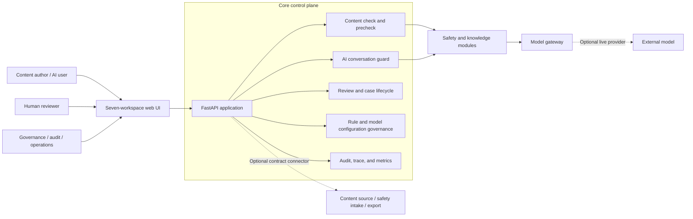
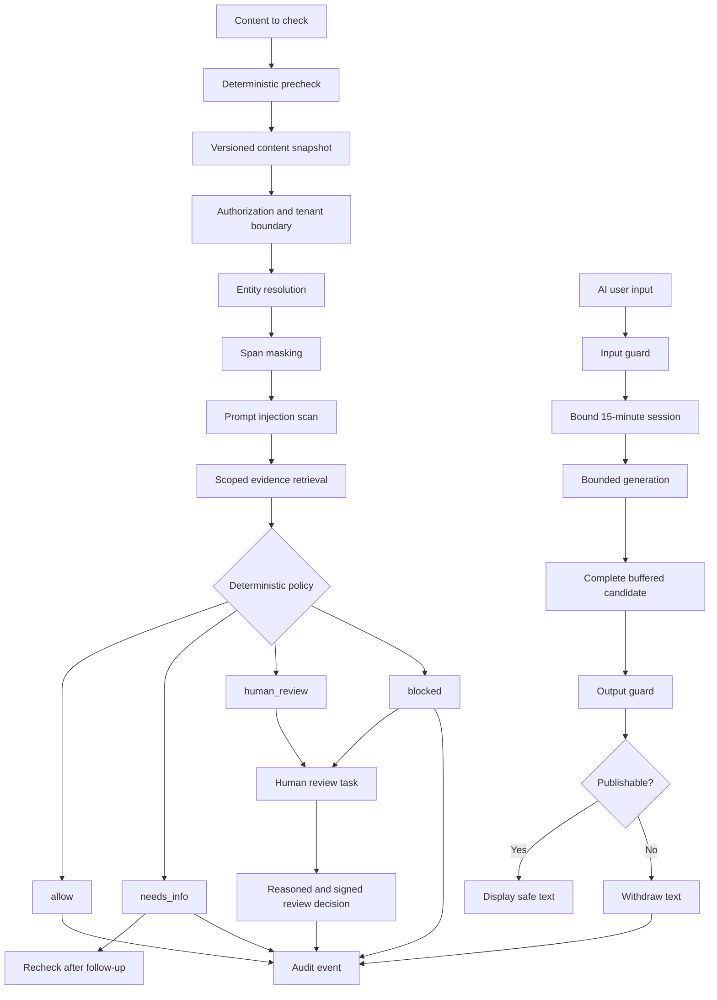
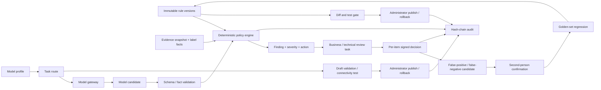
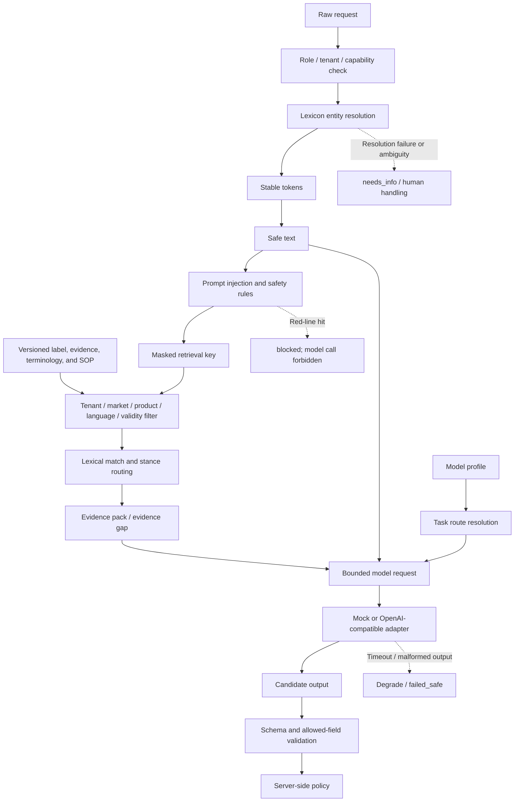
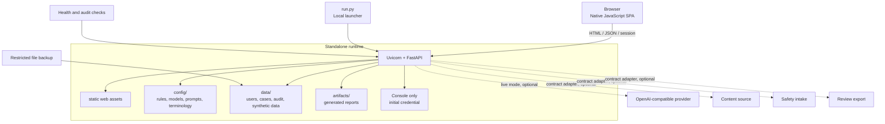

**English** · [简体中文](zh/product-guide.md)

# Compliance AI Guard Product Guide

This guide is for product users, compliance teams, operators, and developers who
use, evaluate, or deploy Compliance AI Guard. It explains the problem the product
solves, how to use its seven workspaces, how to deploy the service, and how a
request moves through content checks, AI conversations, rules, reviews, and
audit.

The guide describes behavior implemented in the current repository. For deeper
implementation details, see [architecture](architecture.md),
[operations](operations.md), [security and risk](security-and-risk.md),
[integration contracts](integration-contracts.md), and
[validation](validation.md). The interactive system architecture diagram is at
[product architecture diagram](assets/product/system-architecture.html).

## 1. Product Background

### 1.1 Problems Addressed

Medical content teams handling customer interaction records, medical information
responses, promotional material, and AI conversations face four connected
problems:

- Risk decisions are spread across manual review, keyword checks, content
  systems, and AI tools. Similar wording can therefore receive inconsistent
  outcomes.
- Large language models can understand semantics and draft replies, but they
  cannot provide stable guarantees for severity, publication authority, review
  routing, and traceability.
- User messages, model input, and model output may contain personal information,
  patient health information, prompt injection, or off-label claims. A miss at
  any one of these points can create data or compliance risk.
- When a model, parser, permission check, or audit write fails, a conventional
  retry-and-continue flow can mistake failure for approval and fail open.

### 1.2 Product Positioning

Compliance AI Guard is a standalone compliance gateway for medical content and
AI conversations. It can check text before it is saved, sent, or published. It
can also guard both the input and output of an AI conversation.

Its core boundary is:

> Models propose candidates. The server-side deterministic policy engine decides
> the disposition, severity, review route, and publication authority.

Models interpret language, extract structured fields, and draft candidate
responses. Versioned rules, server-side code, and authorized reviewers make the
final decision. If a model fails, returns malformed output, or the audit write
fails, the content remains unpublished. A failure does not become approval.

### 1.3 Intended Users

| User | Primary tasks |
| --- | --- |
| Content author, field representative, submitter | Write content, precheck, submit, supply missing information, inspect the result, and appeal |
| Medical, pharmacovigilance, safety, legal, and compliance reviewer | Inspect evidence and findings, then record a reasoned review decision |
| Compliance administrator | Manage rules, review escalation, and model configuration publication and rollback |
| Architect and platform operator | Maintain identity, deployment, model routing, connectors, health, and storage |
| QA, audit, and regulatory affairs | Verify the audit chain, monitor health, review regression candidates, and inspect interface governance evidence |
| Integration developer | Connect checks, conversation guards, and audit capabilities to existing workflows through HTTP APIs |

### 1.4 Scope

This repository provides a runnable synthetic-data demonstration, control logic,
and a validation foundation. It does not contain real customer content,
production connectors, an enterprise identity provider, or regulatory
certification. `allow` means that the current rule version found no issue that
must be stopped. It does not mean legal, medical, or regulatory approval.

The current implementation makes no claim of completed GxP/CSV validation,
pharmacovigilance system validation, medical legal regulatory (MLR) approval, or
any regulatory certification. Deployers must still complete system validation,
privacy assessment, identity integration, and operational approval for their
organization, market, data classification, and applicable regulations.

## 2. Product Principles

### 2.1 Workflow First

The system first performs authorization, entity resolution, masking, and prompt
injection scanning before deciding whether a model may receive the request.
Candidate output must pass schema validation, deterministic policy, and any
required review before publication. Models have no direct publication authority.

### 2.2 Version Binding

Each check result is bound to the exact content version, rule version, knowledge
snapshot, model route, and relevant audit events. Once the content changes, span
locations from the old result are no longer trustworthy and the content must be
checked again. After a rule version changes, existing AI conversations cannot
continue generating responses.

### 2.3 Fail Safe

A model timeout, tool failure, malformed output, masking failure, permission
denial, or audit write failure leaves content blocked, degraded, or queued for
human handling. `MANUAL_DEGRADED`, `FAILED_RETRYABLE`, and `FAILED_SAFE` never
become `ALLOWED`.

### 2.4 Least Privilege and Separation of Duties

Submission, business review, technical review, audit export, configuration
publication, and configuration rollback are separate capabilities. Hiding an
unavailable control in the client is only a usability measure; every protected
API independently checks the actor, role, and tenant.

### 2.5 Privacy Minimization by Default

External models receive only a bounded request. Recognized personal or health
information spans are replaced with stable tokens before the external call, and
the original values are not sent. Audit payloads store identifiers, versions,
digests, dispositions, and aggregate metrics. By default they do not store source
text, token maps, system prompts, or complete model output.

## 3. Quick Start

### 3.1 Requirements

- Python 3.12 or newer. The repository has been verified on Python 3.13.
- Standalone mode uses local JSON/JSONL storage from the Python standard library.
  It requires no external database, message queue, identity provider, or online
  model.
- The browser interface needs no Node.js build chain.

### 3.2 Install and Run in Demo Mode

```bash
python3 -m venv .venv
.venv/bin/python -m pip install -e ".[test]"
LLM_MODE=mock DEMO_MODE=1 PYTHONPATH=src \
  .venv/bin/python -m uvicorn apps.api.main:app \
  --host 127.0.0.1 --port 8000
```

Open <http://127.0.0.1:8000>. `DEMO_MODE=1` skips sign-in and offers four demo
roles: `author`, `reviewer`, `auditor`, and `architect`. Demo roles come from a
request header or an interface selection and are not production authentication.

The one-command launcher is also available:

```bash
LLM_MODE=mock DEMO_MODE=1 python3 run.py
```

This command selects a free port and opens the browser. It is intended for local
evaluation.

### 3.3 Run in Formal Session Mode

```bash
LLM_MODE=mock PYTHONPATH=src \
  .venv/bin/python -m uvicorn apps.api.main:app \
  --host 127.0.0.1 --port 8000
```

The first start generates a temporary `admin` password and prints it once to the
console. Sign in with that account and change the password immediately. A
successful password change invalidates every session for the account, including
the current session. Sign in again with the new password.

Local identity storage provides only minimal sessions. It provides no identity
provider, second factor, or user administration. Before production use, replace
this boundary with the organization's identity, access, and audit systems and
restrict access to the `data/` directory.

### 3.4 Check Service Health

| Endpoint | Purpose |
| --- | --- |
| `GET /health/live` | Checks whether the process is alive without probing downstream dependencies |
| `GET /health/ready` | Checks configuration, dependencies, model credential paths, and demo/live status |
| `GET /health` | Shows the model mode, knowledge snapshot, and configuration version summary |

If `ready` does not pass, repair dependencies or configuration before accepting
new checks or publication operations.

## 4. Identity, Roles, and Permissions

### 4.1 Demo Roles

| Demo role | Available actions |
| --- | --- |
| `author` | Submit content, guard AI input, and inspect the actor's own results |
| `reviewer` | Open business review tasks, inspect evidence, and record decisions |
| `auditor` | Inspect audit evidence, quality posture, and connectors |
| `architect` | Inspect and draft model configuration; cannot publish or roll back |

### 4.2 Permission Model

The server permission matrix also supports submitter, field representative,
pharmacovigilance, medical, safety, legal, compliance, QA, regulatory affairs,
MLR reviewer, QPPV, safety administrator, and system roles. The capabilities
actually available to the current actor come from the matrix returned by
`GET /api/permissions`.

Primary separation-of-duties controls:

| Capability | Typical roles | Control objective |
| --- | --- | --- |
| `submit` | Author, submitter, representative, administrator | Create a formal check |
| `review_case` | Business reviewer, medical, compliance, QPPV, MLR | Review actionable business tasks |
| `audit_export` | Audit, safety, QA, regulatory affairs, compliance administrator | Prevent ordinary business roles from reading audit evidence |
| `architecture_review` | Architect, compliance administrator | Inspect and draft model configuration |
| `config_publish` | Compliance administrator, administrator | Publish a versioned rule or model configuration |
| `config_rollback` | Compliance administrator, administrator | Restore a stable configuration version |

Tenant isolation is enforced in addition to capability checks. A client cannot
gain extra permissions by changing interface state, and cannot reuse an old
result for new text through a highlight, button state, or a previously returned
success flag.

### 4.3 Authentication Endpoints

Formal session mode supports these endpoints:

- `POST /api/auth/login`
- `GET /api/auth/me`
- `POST /api/auth/change-password`
- `POST /api/auth/logout`

After sign-in, the browser holds an HttpOnly session cookie. The `x-demo-role`
header is honored only when `DEMO_MODE=1`; it is not an authentication mechanism
for a formal deployment.

## 5. Interface Conventions and Status Semantics

### 5.1 Seven Workspaces

The interface provides seven workspaces in a fixed order. Press `1` through `7`
to switch between them. These shortcuts do not fire while focus is in an input,
text area, select, or other editable control.

1. `overview`
2. `content_check`
3. `conversation_guard`
4. `reviews`
5. `rules`
6. `quality_audit`
7. `settings`

The upper-right area switches between Chinese and English. Changing language does
not clear content being edited or change server state.

### 5.2 Four Public Dispositions

| Disposition | Meaning | Next action |
| --- | --- | --- |
| `allow` | The current rules found no issue that must be stopped | The content may continue to be saved, sent, or published under the current version |
| `needs_info` | Evidence or business context is missing | Supply the missing fields or evidence and submit again |
| `human_review` | A human specialist must assess the case | Wait for the designated role to inspect evidence and decide |
| `blocked` | The content must not continue under the current conditions | Revise according to guidance, appeal, or escalate |

`refused` is an internal safety terminal state. It indicates that the request
could not be processed safely and is not a normal business approval.

### 5.3 Severity

| Level | Meaning | Handling |
| --- | --- | --- |
| S0 | A red-line issue, such as a serious safety event, severe data exposure, prompt injection, or irreversible write | Block or escalate immediately; self-approval is not allowed |
| S1 | A high-risk issue, such as a potential adverse event, off-label claim, or evidence conflict | A relevant specialist must review; self-approval is not allowed |
| S2 | Missing information or context | Recheck after submitting the missing information; low-risk review tasks may be handled in bulk |
| S3 | A low-risk wording or format suggestion | Revise as suggested; low-risk review tasks may be handled in bulk |

Severity describes risk found by the current rules. It is not a legal
characterization of a person, product, brand, or organization.

### 5.4 Drafts and Recovery

Overview and the independent content check keep a local draft. When the user
returns, the interface shows a "draft found" prompt. Only an explicit "restore
draft" action replaces the current editor, preventing silent data loss.
`Cmd/Ctrl + Enter` submits a business record check from Overview.

## 6. Detailed Feature Guide

### 6.1 Overview: Business Record Check

Overview checks customer interaction records, medical information requests, and
other content that needs business context.

1. Select the source system and upstream record. If a connector is available,
   read a specific version of upstream content.
2. Confirm the product, market, channel, and content language. These fields
   determine evidence retrieval and rule scope.
3. When an image or audio clip must be cited, add an attachment reference. The
   current endpoint registers only the file name, MIME type, size, and reference
   metadata. It does not accept or store binary files.
4. Write or paste the text. A local lexical hint and a server-side deterministic
   precheck may appear while editing. A precheck does not create a case, save the
   submitted text, or call a model.
5. Select "Submit and complete compliance check". A formal submission creates a
   versioned check, invokes bounded model extraction when configuration permits,
   and returns the disposition, severity, findings, spans, evidence, and version
   information.
6. Inspect the "safe view (masked)", risk findings, follow-up actions, cited
   evidence, and audit trail. The interface shows machine codes beside readable
   labels so that an audit can cite the exact value.

Unicode character offsets in a result apply only to the text submitted for that
check. If the text changes, run a new check; do not reuse old highlights or an
old success state.

If the result is `needs_info`, use the follow-up form to supply missing fields.
If an acceptable rewrite is offered, it has already passed a second
deterministic check. The text changes only when the user explicitly selects the
replacement. To revise the current draft, select "Revise this draft and submit
again". This creates a new case while preserving the original case and decision.

### 6.2 Independent Content Check

The independent content check handles promotional copy, medical information
responses, or other text that is not tied to a specific customer interaction.

1. Select the content type on the left.
2. Use the market, language, and product context from Overview.
3. Enter the text to be checked and select "Check content".
4. Inspect the check ID, rule version, content version, workflow state, finding
   list, and optional span highlight.
5. After changing the text, select "Text changed, check again" when it appears.

A result applies only to that text snapshot. Even when two submissions are
similar, cite the check ID, content version, and rule version returned for the
latest server response.

### 6.3 AI Conversation Guard

The conversation guard uses three separate phases: input, generation, and output.
A session is created only after the input passes the required checks. Model text
is shown only after the output check permits publication.

#### Phase 1: Check the Input

1. Enter the message to be sent to the AI.
2. Select "Check and create session".
3. The server performs authorization, entity resolution, masking, prompt
   injection scanning, and input policy checks.
4. If the input is blocked, no session is created and no model is called.
5. If the input passes, the response contains `conversation_id` and establishes
   a server-side session with a 15-minute lifetime.

The session is bound to the actor, tenant, checked-input hash, rule version, and
expiry time. The safe input is held on the server. The client cannot add, rewrite,
or replace the input that the model actually receives.

#### Phase 2: Generate a Candidate

1. Select "Generate safe response".
2. The request must include the same text that was checked. Different text
   returns `conversation_prompt_mismatch`.
3. A changed rule version returns `conversation_requires_recheck`.
4. An expired or closed session returns `conversation_expired`.
5. Generation eligibility is consumed once. The same session cannot be reused
   to obtain another publication permit.

The model receives only the server-held safe input, task constraints, and any
necessary evidence. It cannot set the final decision, severity, review route, or
tool permissions.

#### Phase 3: Check and Display the Output

The complete candidate response is buffered and checked against shared policy
and output-specific rules. It is displayed only when the overall disposition is
`allow` and every finding permits publication. Blocked output is withdrawn. The
model text is not displayed; only the safe state and findings remain.

If generation or output checking cannot complete safely, the endpoint returns
`failed_safe` with HTTP status 503. Do not retry the old session or assemble
unchecked model output. Start a new input check.

### 6.4 Human Review

The Reviews workspace handles business tasks that require human judgment.

1. Open the pending queue. By default it shows medical, safety, compliance, and
   other business tasks.
2. Select a task and inspect the case disposition, workflow state, rule version,
   safe references, findings, evidence, model route, knowledge snapshot, and
   audit timeline.
3. Choose a decision: accept for release, reject and block, escalate for human
   review, or return for missing information.
4. Enter the required rationale. The rationale becomes part of the review record
   and audit event.
5. Submit the decision and verify the signature representation shown by the
   interface.

S0 and S1 tasks cannot select "accept for release", cannot be self-approved, and
cannot be processed in bulk. Only S2 and S3 may be handled in bulk, and a bulk
operation still requires one shared rationale. A signature is bound to the
decision, rationale, task, and actor.

Platform safety and configuration governance tasks are not shown in the business
review queue by default, but they are not deleted. An authorized role can use
`GET /api/reviews?scope=all` to inspect all tasks. Queue filtering does not alter
the underlying disposition, findings, tasks, or audit records.

A reviewer can use "Is this decision wrong?" to flag a false positive or false
negative. A candidate must be confirmed by another authorized colleague before
it enters the golden set, preventing one person from changing a release gate
alone.

### 6.5 Rules

The Rules workspace shows the active rules, rule IDs, finding types, maximum
severity, disposition, and version history. It is primarily a viewing entry
point.

The controlled rule lifecycle is available through APIs:

1. Inspect the current version and history: `GET /api/rules`.
2. Test one rule: `POST /api/rules/test`.
3. Evaluate a batch or the golden set: `POST /api/rules/evaluate`.
4. Compare versions: `GET /api/rules/diff?before=...&after=...`.
5. Publish after the test gate passes: `POST /api/rules/publish`.
6. Restore an immutable historical version: `POST /api/rules/rollback`.

A published rule bundle is immutable. A rule-version change does not rewrite
historical checks; each result retains the policy version that produced it. AI
sessions based on the old version must repeat the input check.

### 6.6 Quality and Audit

This workspace is for QA, audit, safety, regulatory affairs, and compliance
administrators.

1. Inspect audit-chain integrity. A healthy chain returns `ok: true`. On failure,
   inspect `first_broken_seq` and the reason, pause new publications, preserve
   the scene, and investigate.
2. Inspect human oversight health. A very low override rate may indicate
   automation bias. A declining review completion rate may indicate queue
   congestion. Interpret both with the underlying case evidence.
3. Inspect pending false-positive and false-negative regression candidates. A
   second authorized colleague must confirm them.
4. Inspect the `ALCOA+` data-integrity description, interface governance
   checklist, and append-only audit events.
5. For independent verification, call `GET /api/audit-trail/verify` and
   `GET /api/audit-trail`.

Audit records contain the actor, case or trace identifier, time, state
transitions, rule and configuration versions, disposition, safety digests, and
failure category. They do not contain source text, sensitive entity values, token
maps, system prompts, or complete model output by default. Reading and exporting
audit content require the `audit_export` capability.

### 6.7 Settings: Model Profiles and Task Routes

Settings manages model profiles, task routes, and versioned publication
configuration.

1. Select "Refresh" to inspect the current published version, model profiles,
   task routes, credential references, capabilities, data classification, region,
   timeout, token budget, and failure-to-human policy.
2. Use `PUT /api/config/models` to stage a profile and routing draft. The
   interface triggers the corresponding configuration flow through "Save draft".
3. Inspect the draft diff and validation message.
4. Select a test task and run a connectivity test. Mock mode uses an offline
   fixture. Live mode needs configured provider credentials and an endpoint
   mapping.
5. After an authorized administrator checks the diff, select "Publish", or select
   "Roll back" to restore a stable version.

Credentials are stored only as references in configuration and masked when read.
Real secrets belong in environment variables or a local file excluded by
gitignore. They must not be committed, written to audit records, or displayed in
the interface.

Live model-provider mode has not been validated in a customer environment.
Before enabling it, independently validate provider data residency, credential
rotation, timeout behavior, rate limits, output schema, failure-to-human routing,
and cost.

## 7. End-to-End User Journeys

### 7.1 Typical Content Author Journey

1. Select context and write business content in Overview.
2. Use local hints and deterministic precheck to find issues early.
3. Submit formally and receive `allow`, `needs_info`, `human_review`, or
   `blocked`.
4. Supply information for `needs_info`; create a new check from the original
   draft when the content is eligible for revision.
5. Wait for a specialist decision on `human_review` and inspect the result when
   it is available.
6. For `blocked`, revise according to the remediation direction, appeal, or
   escalate. An appeal does not immediately lift the block.

### 7.2 Typical Reviewer Journey

1. Open the business review queue and prioritize tasks beyond SLA.
2. Inspect safe references, source finding text, evidence versions, and system
   disposition.
3. Enter a rationale for each decision, submit it, and verify the signature
   representation.
4. Create a candidate regression case for a false positive or false negative,
   then wait for a second-person confirmation.
5. Explicitly escalate or block S0/S1 tasks. Do not weaken oversight through bulk
   handling.

### 7.3 Typical Governance and Operations Journey

1. Check `/health/ready` and the configuration version.
2. Inspect rule history and model routes, then validate changes in a draft or test
   version.
3. Before publication, inspect the diff, golden-set result, audit-chain state,
   and regression candidates.
4. An authorized administrator publishes or rolls back and confirms that audit
   events were written.
5. Periodically review review SLA, override rate, completion rate, model failure
   categories, and storage retention.

## 8. API Quick Examples

### 8.1 Persistent Content Check

In demo mode, the request can be sent directly. Formal mode uses the session
cookie.

```bash
curl -X POST http://127.0.0.1:8000/api/checks \
  -H 'Content-Type: application/json' \
  -d '{
    "tenant_id": "TENANT-EN",
    "market": "US",
    "language": "en",
    "product_id": "PRODUCT-001",
    "content_type": "customer_interaction_note",
    "content": "The patient developed a rash after taking the medicine."
  }'
```

Treat the response as a versioned case. Do not rely only on the HTTP success
status. Read `decision`, `severity`, `findings`, `policy_version`, and
`content_version`.

### 8.2 AI Input Check and Generation

Demo mode:

```bash
curl -X POST http://127.0.0.1:8000/api/conversations/guard-input \
  -H 'Content-Type: application/json' \
  -H 'x-demo-role: field_rep' \
  -d '{
    "tenant_id": "TENANT-A",
    "content": "Summarize the safety information to consider when adults use this hypertension medicine.",
    "language": "en",
    "market": "US",
    "product_id": "PRODUCT-A"
  }'
```

Save `conversation_id` from the response, then submit exactly the same text:

```bash
curl -X POST \
  http://127.0.0.1:8000/api/conversations/<conversation_id>/generate \
  -H 'Content-Type: application/json' \
  -H 'x-demo-role: field_rep' \
  -d '{
    "tenant_id": "TENANT-A",
    "content": "Summarize the safety information to consider when adults use this hypertension medicine."
  }'
```

Remove `x-demo-role` in a formal deployment and use the HttpOnly session cookie
created by sign-in.

### 8.3 Main Endpoint Index

| Capability | Endpoint |
| --- | --- |
| Fast precheck | `POST /api/checks/precheck` |
| Persistent content check | `POST /api/checks` |
| Frontend-compatible check entry | `POST /api/cases/check` |
| Frontend-compatible precheck entry | `POST /api/cases/precheck` |
| AI input check | `POST /api/conversations/guard-input` |
| AI generation | `POST /api/conversations/{id}/generate` |
| Case list and detail | `GET /api/cases`, `GET /api/cases/{case_id}` |
| Revision and follow-up | `POST /api/cases/{case_id}/revise`, `POST /api/cases/{case_id}/followup` |
| Appeals | `POST /api/cases/{case_id}/appeal`, `GET /api/appeals` |
| Review queue and decision | `GET /api/reviews`, `POST /api/reviews/{task_id}/decision` |
| Audit trail | `GET /api/audit-trail`, `GET /api/audit-trail/verify` |
| Metrics | `GET /api/metrics` |
| Permission matrix | `GET /api/permissions` |
| Connectors and sources | `GET /api/connectors`, `GET /api/sources` |
| Model configuration | `GET/PUT /api/config/models`, `POST /api/config/publish` |

Integrators should use `/api/checks` as the formal content-check entry point.
`/api/cases/check` and `/api/cases/precheck` are compatibility entries used by
the current frontend. A publishing system should inspect `decision` and the
allowed action on every finding. A successfully created case alone does not mean
the content may be published.

## 9. System Architecture

Compliance AI Guard is a standalone system consisting of one FastAPI service and
a native browser interface. Modules cooperate through shared domain contracts and
require no database, queue, or message bus. External models and connectors are
optional replacement seams.

### 9.1 System Context and Containers



The seven workspaces are different entry points into the same control plane.
Content checks and the conversation guard share rule, finding, review, and audit
semantics. A rule or model configuration change does not create two unrelated
checking stacks.

### 9.2 Content Check and AI Conversation Path



Two ordering constraints cannot be reversed. Entity resolution must precede
masking so that one identity is not split into multiple tokens. Prompt injection
scanning must precede any model access. AI output must be fully buffered and
checked before display; it cannot be streamed first and repaired later.

### 9.3 Rules, Review, Audit, and Model Governance



Rule bundles, model configurations, and review decisions are traceable business
facts. If audit writing fails during publication or rollback, the publication
must remain paused.

### 9.4 Safety, Knowledge, and Model Gateway Modules



Masking replaces only recognized entity spans; it does not rewrite the entire
business narrative. Under-masking can expose an identifier, while over-masking can
remove the context needed for a decision. Neither failure can become a
publication permit. Missing evidence becomes an explicit evidence gap and cannot
silently become approval.

### 9.5 Deployment, Storage, and Optional Connectors



Standalone mode writes state to local JSON/JSONL. `data/`, `artifacts/`, and
local secret files must not be committed. A real deployment needs organizational
processes for storage permissions, encryption, backup, retention, and recovery.
The repository does not supply a production database or key-management service.

## 10. Data, Security, and Failure Handling

### 10.1 Data Minimization

- A precheck creates no case, stores no submitted text, and calls no model.
- An external model receives only masked safe text, necessary evidence, and
  bounded context.
- Audit records contain only digests, identifiers, versions, state, and aggregate
  metrics by default. They exclude full source text and model replies.
- The attachment endpoint stores only reference metadata, not binary files.

### 10.2 Audit Integrity

The audit ledger is an append-only hash chain. Each record contains the previous
record's hash, a canonical safe payload, and a digest.
`GET /api/audit-trail/verify` returns the first unverifiable position, the reason,
the number of checked entries, and the chain-head hash. Historical entries written
before the chain existed are reported separately and must not be described as
covered by the chain.

Audit export, audit verification, and publication are separate authorizations.
When the result is `ok: false`, pause new publications, preserve the ledger and
runtime evidence, and investigate storage, permissions, imports, or unauthorized
modification.

### 10.3 Failures and Retries

| Condition | Expected state | Action |
| --- | --- | --- |
| Short-lived dependency error | `FAILED_RETRYABLE` | Retry within a bounded budget, then hand off to a human |
| Model timeout or malformed candidate | `MANUAL_DEGRADED` | Keep unpublished and retry under the current policy and route or hand off |
| Masking, authorization, audit, or other unsafe-processing failure | `FAILED_SAFE` | Do not release; preserve the safe error and escalate |
| Conversation text mismatch | `conversation_prompt_mismatch` | Repeat the input check; do not reuse the old session |
| Rule version changed | `conversation_requires_recheck` | Recheck the input under the current rules |
| Session expired | `conversation_expired` | Establish a new 15-minute session |

No error handler may rewrite a historical decision or turn a degraded state into
approval.

## 11. Connectors and Integrations

The repository contains contract-level adapters for content source, safety intake,
and review export. They demonstrate versions, idempotency, health, retries, and
dead-letter handling. They use memory or synthetic data and are not real customer
system connectors.

Integration notes:

- An upstream record needs a version. A stale or conflicting version must not be
  silently trusted.
- Event processing needs an idempotency key and bounded retries. Failed events
  must enter an inspectable dead-letter path.
- A connector can participate in a publication decision only when its declared
  data classification, actions, and region permit it.
- A missing connector does not block core checks, rules, review, or audit. A team
  may select manual upload or use the API directly.
- `POST /api/attachments` returns only an `image_ref` or `audio_ref` metadata
  reference. It does not store file content and is not a multimodal file-hosting
  service.

## 12. Validation and Pilot Decisions

The current validation entry point is `release_gate`. The release gate requires
the combined evaluation to pass, including 44 golden-set cases and 12
entity/masking cases. Results and reproduction steps are in
[validation](validation.md).

When evaluating a pilot, inspect all of the following rather than only the number
of blocks:

| Metric | Purpose |
| --- | --- |
| Golden-set pass rate and risk-category recall | Whether rules detect target risks |
| Good-content false-positive and override rates | Whether review is being bypassed |
| Review completion rate and SLA breaches | Whether the human workflow is operable |
| Second-person-confirmed regression candidates | Whether feedback improves rules |
| Model failure, degradation, and `failed_safe` rates | Whether dependency behavior disrupts the workflow |
| Audit-chain verification result | Whether evidence remains intact |
| Conversation recheck rate | Whether version binding causes usability problems |

Use these metrics with thresholds agreed by the organization. The repository
provides no real-customer baseline, and synthetic-data results must not be
presented as proof of production accuracy.

## 13. Current Limits and Pre-Launch Checks

Known current limits:

- Standalone storage is local JSON/JSONL, not a highly available database or
  distributed queue.
- Local identity provides password sessions only, with no enterprise SSO,
  multifactor authentication, or user administration.
- Connectors are contract-level demonstrations with no real customer system
  connection.
- Mock mode is for development, demonstration, and automated testing. Live model
  providers have not completed customer-environment validation.
- The Rules UI primarily shows current rules and history. The full lifecycle uses
  controlled APIs.
- The project makes no claim of completed GxP/CSV, pharmacovigilance, MLR,
  privacy, or regulatory certification.

Before launch, confirm the tenant and identity model, data residency, storage
encryption and backup, secret rotation, log retention, connector validation,
provider SLA, emergency manual workflow, rule ownership, review SLA, and audit
export permissions.

## 14. Documentation Index

| Document | Contents |
| --- | --- |
| [Architecture](architecture.md) | Shared control plane, request paths, policy rules, data model, and failure states |
| [Operations](operations.md) | Installation, workspaces, rule and model lifecycle, live mode, and failure handling |
| [Security and risk](security-and-risk.md) | Threat model, security controls, failure semantics, and risk boundaries |
| [Validation](validation.md) | Release gate, golden set, entity checks, and reproduction |
| [Integration contracts](integration-contracts.md) | Content-source, safety-intake, and review-export interfaces |
| [Architecture decision](decisions/0001-workflow-first-controlled-agent.md) | Rationale for workflow-first, model-candidate design |
| [简体中文产品手册](zh/product-guide.md) | Chinese version of this guide |
