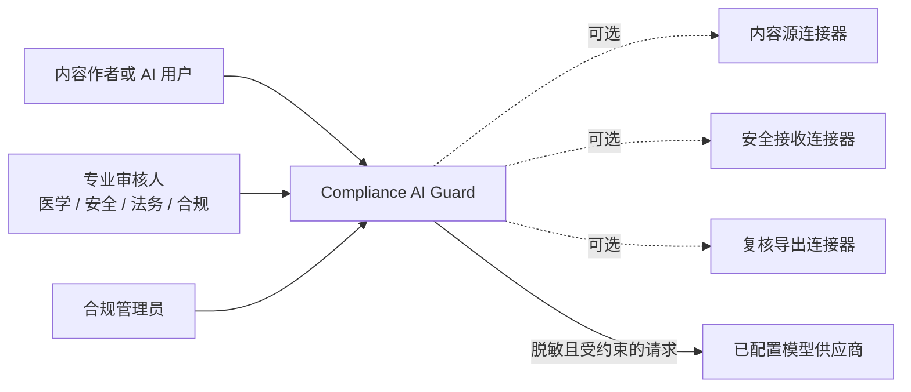
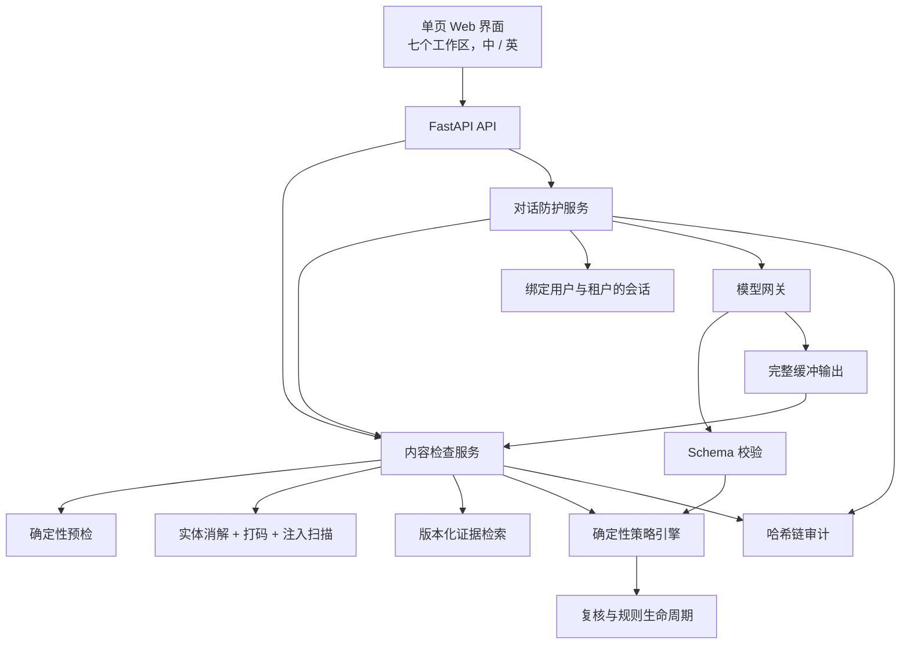
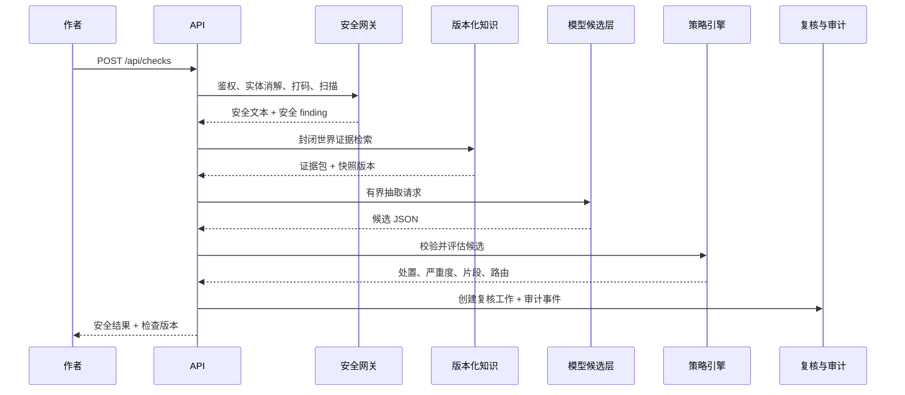
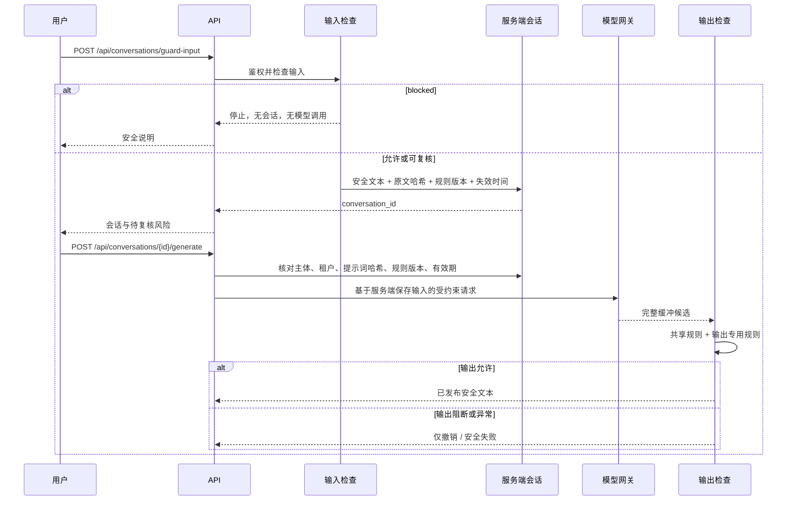
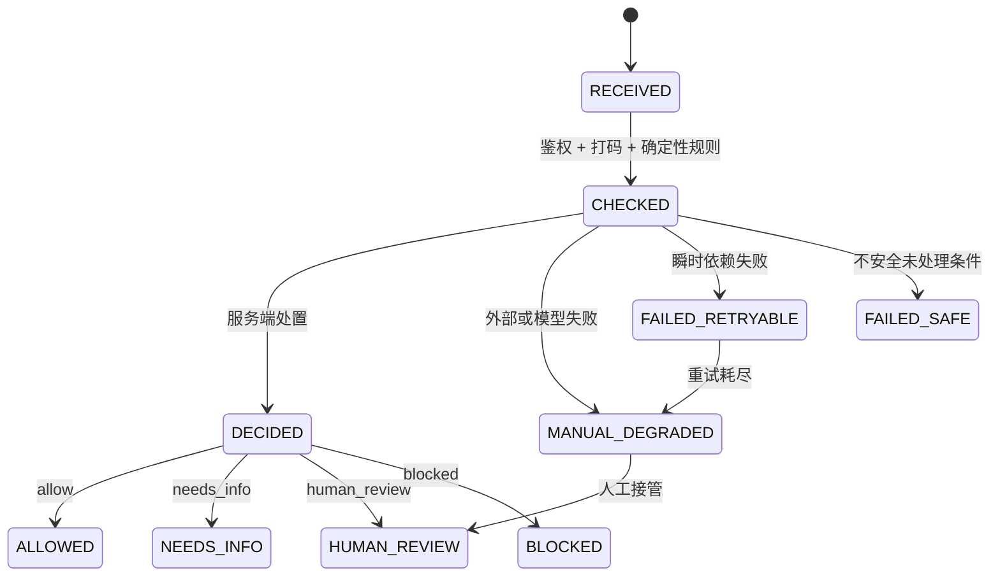

# 架构设计

[English](../architecture.md) · **简体中文**

## 1. 产品边界

Compliance AI Guard 是面向医疗内容与 AI 对话的独立控制服务。它可以直接接收
内容，也可以通过可选的供应商中立连接器接入。运行不依赖特定客户系统、业务
对象模型、供应商 SDK、数据库、消息队列、身份提供商或在线模型。

两个公共入口共享一个控制面：

- `POST /api/checks`：在保存、发送或发布前检查文本。
- `POST /api/conversations/guard-input`：在生成会话存在前检查不可信 AI 输入。

内容路径与对话路径共享规则包、策略引擎、finding 结构、复核队列、规则生命周期
和审计链。因此一次规则更新不会让同一风险在两个入口得到两种含义。

## 2. 核心决策：工作流优先，模型只产出候选

模型可以理解语言、抽取结构化字段、提出 finding 和起草回复，但不能设置最终
处置、严重度、批准状态、复核路由、发布权限或工具权限。

| 关注点 | 归属 | 理由 |
| --- | --- | --- |
| 语言理解与有界抽取 | 模型候选层 | 合理使用概率能力 |
| 处置、严重度、路由、权限 | 确定性策略引擎 | 可复现、可审查 |
| 输入、生成、输出状态流转 | 服务端工作流代码 | 不允许失效开放 |
| 证据可采性与版本 | 检索层 | 必须过滤并可回放 |
| 人工复核后的发布 | 复核与审计服务 | 必须可归属 |

被否定的替代方案是让自主循环选择工具和最终发布结论。在合规链路里，控制步骤
的顺序本身就是控制措施。参见
[decisions/0001-workflow-first-controlled-agent.md](decisions/0001-workflow-first-controlled-agent.md)。

## 3. 系统上下文



虚线表示契约，不是必需服务。独立模式完全在本地运行。每个可选连接器都会声明
数据分级、允许动作、版本行为和健康状态。参见
[integration-contracts.md](integration-contracts.md)。

## 4. 容器视图



模型网关没有指向发布权限的边。候选输出经过 Schema 校验和服务端策略判断；
对话输出必须再次经过同一内容检查路径，才能显示。

## 5. 内容检查路径



编辑期间的 `POST /api/checks/precheck` 路径更短：只做脱敏后的确定性检查，
不创建案例，也不调用模型。

有两个顺序不能交换：

1. 实体消解先于打码，使一个人得到同一个 token。
2. 提示注入扫描先于模型访问。

## 6. AI 对话：输入、生成、输出



生成请求必须携带已经检查的同一份文本。哈希不一致返回
`conversation_prompt_mismatch`；规则版本变化返回
`conversation_requires_recheck`；会话过期或关闭返回 `conversation_expired`。
这些检查阻止客户端把旧的成功标志变成对新提示词的授权。

回复完整缓冲后才检查。被阻断输出不回显正文，只返回安全的 finding 与状态。
生成或输出检查异常时进入 `failed_safe`，不发布任何文本。

## 7. 处置、严重度与动作

公共处置为 `allow`、`needs_info`、`human_review`、`blocked`。`refused` 是
无法安全处理的请求所使用的内部终态。

| 严重度 | 含义 |
| --- | --- |
| **S0** | 红线。需要立即升级或阻断的安全条件 |
| **S1** | 高风险，需要专业复核 |
| **S2** | 缺少信息或上下文，补齐后重跑 |
| **S3** | 低风险措辞或格式提示 |

每个 finding 带有 `allow_save`、`allow_generate`、`allow_publish`。输入只有在
未被阻断且所有 finding 都允许生成时才能建立会话。输出只在总处置为 `allow`
且所有 finding 都允许发布时显示。S0 与 S1 不允许自我批准。

## 8. 共享策略规则

默认规则包为 `config/policies/general-medical-demo.json`，版本
`GENERAL-MEDICAL-2026-01`，共 21 条规则。规则携带内容类型、入口范围、
模式或推导条件、严重度、处置、所需角色、SLA、整改建议、证据要求和片段要求。

| 规则 | Finding | 严重度 | 决定 | 路由至 | SLA |
| --- | --- | --- | --- | --- | --- |
| CN-001 | `potential_adverse_event` | S1 | human_review | 安全 + 医学 | 8h |
| CN-002 | `serious_adverse_event` | S0 | human_review | 安全 + 医学 | 4h |
| CN-003 | `bribery_or_inducement` | S1 | blocked | 合规 + 法务 | 8h |
| CN-004 | `comparative_claim` | S1 | human_review | 合规 + 医学 | 8h |
| CN-005 | `prompt_injection` | S0 | blocked | 合规管理员 | 立即 |
| CN-006 | `pii` | S1 | human_review | 合规管理员 | 8h |
| CN-007 | `phi` | S1 | human_review | 合规管理员 | 8h |
| CN-008 | `severe_pii_leak` | S0 | blocked | 合规管理员 | 立即 |
| CN-009 | `off_label` | S1 | human_review | 合规 + 医学 | 8h |
| CN-010 | `evidence_conflict` | S1 | human_review | 合规 + 医学 | 8h |
| CN-011 | `expired_evidence` | S1 | human_review | 提交人 + 医学 | 24h |
| CN-012 | `missing_evidence` | S2 | needs_info | 提交人 + 医学 | 24h |
| CN-013 | `missing_context` | S2 | needs_info | 审核人 | 24h |
| CN-014 | `permission_failure` | S1 | blocked | 合规管理员 | 8h |
| CN-015 | `irreversible_write` | S0 | blocked | 合规管理员 | 立即 |
| CN-016 | `security_issue` | S1 | blocked | 合规管理员 | 8h |
| CN-017 | `unapproved_promotion` | S0 | blocked | 合规 + 法务 | 4h |
| CN-018 | `formatting` | S3 | allow | 审核人 | 72h |
| CN-019 | `ambiguous_entity` | S2 | needs_info | 审核人 | 24h |
| CN-020 | `claim_discrepancy` | S1 | human_review | 合规 + 医学 | 8h |
| CN-021 | `unresolved_indication` | S2 | needs_info | 医学 | 24h |

超出有效期的规则包会在启动时被拒绝。规则以不可变版本完成起草、测试、评估、
发布和回滚。历史结果保留产生它的策略版本。

## 9. 内容模型与片段

检查请求携带 `tenant_id`、`content_type`、可选细分类型、市场、语言、可选产品
与治疗领域、正文或内容分段、可选结构化字段、请求规则版本、留存策略、外部
关联 ID 和客户端内容版本。

`content_type` 使用通用值：客户互动记录、医学信息请求、医学事务记录、推广内容、
AI 对话或其他。外部关联 ID 只用于调用方关联，不参与策略判定。

Finding 使用相对于本次精确提交版本的 Unicode 字符偏移。客户端文本哈希与服务端
结果版本不一致时，片段标记为失效，界面要求重新检查。规则无法可靠提供片段时，
保留 finding 并让片段为空；系统不会搜索相似文本，再把猜测位置当作证据。

## 10. 证据与超适应症比对

完整产品标签不作为请求载荷发送。标签在接入阶段结构化为版本化事实。模型可以
抽取适应症、人群、治疗线数、剂量、给药途径、疗程和联合用药作为候选。服务端
逐字段与证据快照比对。

适应症优先按概念 ID 匹配，只有在没有 ID 时才回退到文本。不一致时记录具体
`label_field:<字段名>` 并产生 CN-009。检索按租户、市场、产品、语言、状态、
有效期与访问范围过滤。没有证据得到 CN-012，永远不会放行。

## 11. 保留语义的打码

打码不足会泄露标识符。打码过度会破坏叙述，并可能在规则读取文本前删除安全
关键词。两个方向都是发布门禁。

- 姓名识别使用配置词典，只替换命中的姓名片段。
- 实体消解先于打码，别名得到同一个稳定 token。
- 两个可能的真实身份不会被静默合并；歧义转为补充信息。
- 打码组件在本地确定性运行。
- 打码召回率与源保真度下限均为 1.0。

## 12. 模型网关与路由

任务路由根据能力、区域、数据分级和发布状态选择。档案保存不透明的凭据引用，
真实凭据位于环境变量或被 gitignore 的密钥文件。审计记录
`model_profile_id` 作为稳定业务路由，并记录 `model_upstream` 作为实际应答模型。

草稿校验会拒绝明文密钥、字面量 endpoint、不完整能力声明以及不兼容的区域或
数据分级组合。发布会创建不可变 `v{n}` 快照，回滚恢复先前稳定快照。两者都需要
管理员权限并写入审计。

## 13. 失败状态



**不变量：任何失败或降级状态都不能转到 `ALLOWED`。** 输入失败不生成；输出
失败不发布；审计失败则发布失败；模型或连接器故障转人工。`FAILED_SAFE`、
`FAILED_RETRYABLE` 与 `MANUAL_DEGRADED` 都保持可见。

## 14. 复核、规则与审计

复核任务按规则 finding 与所需角色创建。队列过滤不会删除底层处置、finding、
任务或审计事件。`scope=all` 保持技术工作可见。复核决定带与签署内容绑定的
签名表现形式，S0 与 S1 不能自我批准。

质量与审计工作区组合哈希链校验、监督指标、候选回归用例、连接器清单和仅追加
事件视图。每条记录携带 `sha256(prev_hash + 规范化正文)`。
`GET /api/audit-trail/verify` 指出第一个不可信位置。审计载荷只使用摘要、标识、
版本和聚合值，不包含原始正文或 token 映射。

## 15. 界面信息架构

单页界面包含七个按下列顺序排列的工作区：

| 工作区 | 作用 |
| --- | --- |
| `overview` | 上下文、状态和快捷入口 |
| `content_check` | 任意内容提交 |
| `conversation_guard` | 输入、生成、输出状态 |
| `reviews` | 专业复核队列 |
| `rules` | 规则查看与受控生命周期 |
| `quality_audit` | 审计与质量证据 |
| `settings` | 模型档案、路由和版本 |

服务端返回能力矩阵。客户端隐藏控件提升易用性，但所有端点仍独立检查权限。
切换语言会保留草稿与界面状态。机器代码始终与易读标签并列显示。

## 16. 代码结构

```text
apps/api/          FastAPI 应用与路由处理
src/compliance_guard/
  agents/          有界模型抽取与生成步骤
  audit/           哈希链、Trace、指标、签名表现形式
  domain/          共享枚举、请求、响应与 finding
  integrations/    可选内容源、安全接收与导出契约
  knowledge/       标签事实、检索、证据包、适应症映射
  llm/             模型网关、档案、路由、mock 与 live 适配器
  policy/          规则 Schema、引擎、优先级、规则包、路由
  review/          复核队列、决定、生命周期、反馈
  security/        实体消解、打码、注入扫描、鉴权
  workflow/        内容检查、对话防护、预检、编排
  web/             七工作区双语界面
config/            策略包、提示词、模型档案、路由、术语表
data/              合成数据、黄金集、mock 响应
tests/             单元、契约、集成、安全、评估
```
