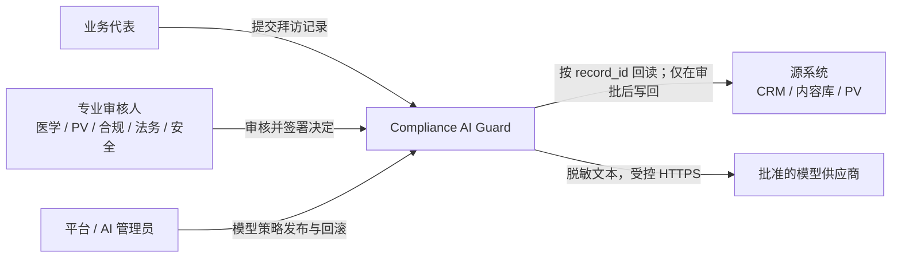
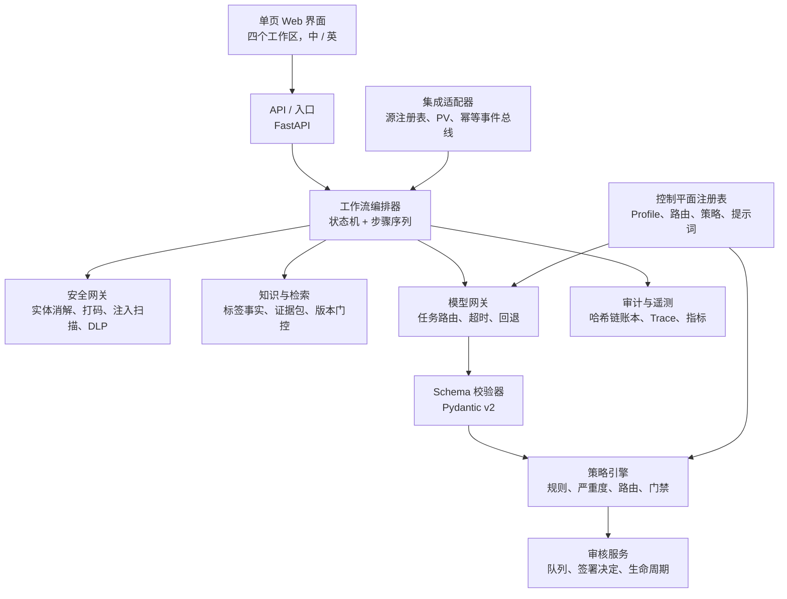
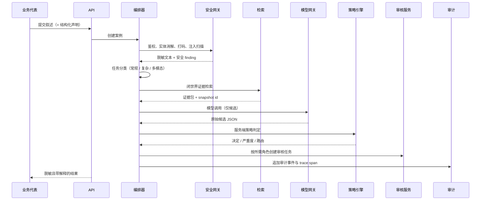
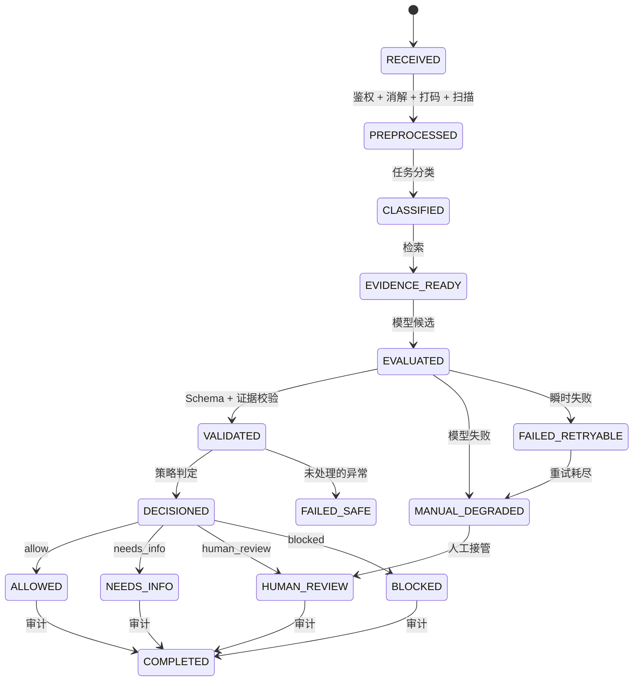

# 架构设计

[English](../architecture.md) · **简体中文**

## 1. 核心决策：Workflow-first，模型只产出候选

**模型不做决定。** 它读懂中文自由文本并返回结构化候选；服务端做决定。

一切带有后果的东西——决定、严重度、审核路由、批准状态、工具权限——都由确定性策略引擎和代码控制的状态机产出。这个切分就是整套设计，也正因如此，一个案例可以被回放、被审计、被解释清楚，而不需要去问模型"你当时在想什么"。

| 关注点 | 归属 | 理由 |
| --- | --- | --- |
| 理解中文叙述、抽取标签字段 | 模型 | 语言模型擅长的任务 |
| 决定、严重度、路由、权限 | 策略引擎（代码） | 必须可复现、可审查 |
| 状态流转、失败处理 | 状态机（代码） | 必须永不失效开放（fail-open） |
| 证据可采性、版本控制 | 检索层（代码） | 必须版本受控、可过滤 |

被否掉的替代方案是：让自主 Agent 自行决定步骤、工具和放行结论。在合规链路里，**步骤序列本身就是控制措施**，而开放式循环无法验证、无法回放、也无法向审核人解释。参见 [decisions/0001-workflow-first-controlled-agent.md](decisions/0001-workflow-first-controlled-agent.md)。

## 2. 系统上下文



源系统与 PV 边界均以**仅契约适配器**实现。它们演练了真实集成所需的各项不变量（回读、版本拒绝、审批门控写入、幂等），但不接触任何真实系统。详见 [integration-contracts.md](integration-contracts.md)。

## 3. 容器视图



注意模型周围箭头的方向：网关把候选返回给**校验器**，校验器再把已校验的候选交给**策略引擎**。**模型没有任何一条指向决定的边。**

## 4. 请求路径



有两个顺序是承重的。**实体消解在打码之前**，所以一个人对应一个 token。**注入扫描在模型调用之前**，所以恶意指令根本到不了模型。

## 5. 状态与失败路径



**不变量：案例永远不可能从失败或降级状态到达 `ALLOWED`。** 所有已配置路由都带 `requires_human_on_failure: true`，因此每一类模型失败——超时、Schema 违规、连接错误——都会落到 `MANUAL_DEGRADED` 并生成人工审核任务，绝不会变成静默放行。

`FAILED_SAFE` 由未处理的异常和显式失效安全事件到达。如果某条路由关闭了 `requires_human_on_failure`，那么 `audit`/`permission`/`policy`/`schema` 类别的模型失败也会走到这里——这个降级阶梯是真实实现的，不只是文档描述。

## 6. 决定与严重度

四种决定：`allow`、`needs_info`、`human_review`、`blocked`（外加用于不安全错误的 `refused`）。

| 严重度 | 含义 |
| --- | --- |
| **S0** | 红线。严重不良事件、数据泄露、注入：立即拦截或升级，永不允许自我批准 |
| **S1** | 高风险。需要专业审核（PV / 医学 / 合规 / 安全） |
| **S2** | 需补信息。证据或上下文不足；补齐后重跑 |
| **S3** | 低风险。仅措辞或格式建议 |

S0 与 S1 不可自我批准；审核界面对这两级禁用"接受"选项。

## 7. 策略规则

`config/policies/cn-demo.json` 中共 21 条规则，版本号 `CN-COMPLIANCE-2026-01`。每条携带模式、严重度、决定、所需角色、SLA，以及是否可接受证据缺口。

| 规则 | Finding | 严重度 | 决定 | 路由至 | SLA |
| --- | --- | --- | --- | --- | --- |
| CN-001 | `potential_adverse_event` | S1 | human_review | PV + 医学 | 8h |
| CN-002 | `serious_adverse_event` | S0 | human_review | PV + 医学 | 4h |
| CN-003 | `bribery_or_inducement` | S1 | blocked | 合规 + 法务 | 8h |
| CN-004 | `comparative_claim` | S1 | human_review | 合规 + 医学 | 8h |
| CN-005 | `prompt_injection` | S0 | blocked | 安全 | 立即 |
| CN-006 | `pii` | S1 | human_review | 安全 | 8h |
| CN-007 | `phi` | S1 | human_review | 安全 | 8h |
| CN-008 | `severe_pii_leak` | S0 | blocked | 安全 | 立即 |
| CN-009 | `off_label` | S1 | human_review | 合规 + 医学 | 8h |
| CN-010 | `evidence_conflict` | S1 | human_review | 合规 + 医学 | 8h |
| CN-011 | `expired_evidence` | S1 | human_review | 代表 + 医学 | 24h |
| CN-012 | `missing_evidence` | S2 | needs_info | 代表 + 医学 | 24h |
| CN-013 | `missing_context` | S2 | needs_info | 审核人 | 24h |
| CN-014 | `permission_failure` | S1 | blocked | 安全 | 8h |
| CN-015 | `irreversible_write` | S0 | blocked | 管理员 | 立即 |
| CN-016 | `security_issue` | S1 | blocked | 安全 | 8h |
| CN-017 | `unapproved_promotion` | S0 | blocked | 合规 + 法务 | 4h |
| CN-018 | `formatting` | S3 | allow | 审核人 | 72h |
| CN-019 | `ambiguous_entity` | S2 | needs_info | 审核人 | 24h |
| CN-020 | `claim_discrepancy` | S1 | human_review | 合规 + 医学 | 8h |
| CN-021 | `unresolved_indication` | S2 | needs_info | 医学 | 24h |

超过 `effective_until` 的策略包会在启动时被拒绝，而不是被放任继续判定案例。

## 8. 超适应症检测：字段比对，而非模型意见

问模型"这是超适应症吗"会在三个地方失败：完整中文说明书有数万字，塞不进请求预算；无关的说明书叙述（例如安慰剂组副作用）会污染判断；而得到的答案无法与任何东西核对。

因此工作被切分为：

1. **说明书在接入阶段就结构化**，而非运行时读全文——按产品、市场、语言、版本存储为标签事实（`knowledge/label_facts.py`）。
2. **模型只抽取七个固定字段**：适应症、人群、治疗线数、剂量、给药途径、疗程、联合用药。**从不要求它给出结论。**
3. **服务端逐字段比对**（`compare_label_fields`）。适应症优先按概念 id 匹配，只有在没有 id 时才回退到文本比对，因此"高血压"与"原发性高血压"不会造成误判。
4. **不一致触发 CN-009**（S1），并把具体失败字段记为 `label_field:<字段名>`，审核人能看到是哪次比对失败。
5. **检索是闭世界的**——按租户、市场、产品、语言、状态、有效期、访问范围过滤。检索不到就是证据缺口（CN-012，`needs_info`），**绝不是放行**。

本地适应症本体把口语化表述（"血压高"）映射到概念 id，因此送到模型的是单个产品的结构化事实，而不是说明书原文。**请求体积与产品目录规模由此解耦。**

## 9. 保留语义的打码

打码有两种失败模式，而危险的那个并不是显而易见的那个。

**打码不足**会泄露标识符。**打码过度**会删掉叙述——这才是隐蔽的失败：早期基于正则的实现会替换整个匹配段，于是"赠送礼品给医生"丢掉了承载"礼品"的字符，商业红线规则不再触发。案例仍被拦截，但靠的是 PII 规则，而不是那条真正描述问题的规则。同一机制也可能在安全规则运行之前抹掉不良事件关键词。

当前设计：

- 姓名识别锚定在姓氏词典（`config/surnames.json`）上，**只替换姓名本身**，因此"患者"和"医生"得以保留。
- **实体消解在打码之前执行**，因此章三 / 章医生 / 章主任消解为同一身份、同一稳定 token。两个同姓的不同人会被标记为待确认而非合并——把临床医生的意见错误归属给他人，比多问一句澄清更糟。
- 这是唯一会看到真实姓名的组件，因此按设计保持本地化与确定性。

两个方向都作为发布门禁被度量：打码召回率必须为 1.0，**源保真度**也必须为 1.0（打码没有损坏任何非标识符内容）。

## 10. 客户端输入不是事实

结构化表单字段以 `claimed_fields` 进入。决定读取的是 `resolved_fields`，即服务端从叙述本身推导出的结果。与文本矛盾的声明会变成 `claim_discrepancy` finding（CN-020），而不是静默绕过。保留键（`decision`、`severity`、`approval_status`、`routing`、`tool_permissions`）永远无法从入参设置。

## 11. 模型网关与路由

三个业务 profile 映射到三条任务路由。路由是确定性的，每次调用都会针对能力、区域、数据分级和已发布/启用状态做校验；不兼容的路由会直接抛错而不是猜测。

| 任务路由 | 主 Profile | 回退 | 数据分级 |
| --- | --- | --- | --- |
| `routine_compliance` | `deepseek-routine` | `kimi-complex` | pii_tokenized、confidential、internal、public |
| `complex_evidence_reasoning` | `kimi-complex` | 无 | internal、confidential、pii_tokenized |
| `multimodal_extraction` | `minimax-multimodal` | 无 | pii_tokenized、phi_tokenized |

Profile 只持有不透明的 `endpoint_ref`；真实上游模型 id 存在 `config/endpoints/<profile>.json`，而凭据完全不在代码仓库内。这样审计轨迹才稳定：`model_profile_id` 记录业务路由名，`model_upstream` 记录真正应答的供应商模型，**因此把某个 profile 重新指向另一个模型，永远不会改写历史案例的含义**。

发布是版本化的：起草 → 校验 → 发布（`v{n}`）→ 回滚，需管理员权限并全程审计。草稿校验会在发布前拒绝明文密钥、字面量 endpoint，以及不兼容的能力/区域/数据分级组合。

## 12. 两层预检

两层都不调用模型。

| 层 | 触发 | 运行位置 | 预算 |
| --- | --- | --- | --- |
| **L0** 本地词元 | 每次击键，120 ms 防抖 | 仅浏览器，无请求 | 即时 |
| **L1** 确定性预检 | 停顿 400 ms、失焦或粘贴 | `POST /api/cases/precheck` | p95 < 300 ms（实测约 0.3 ms） |

三个刻意设计的性质：**L0 永远不会说内容看起来没问题**（本地词表支撑不起"未发现问题"，虚假安心会让使用者误以为沉默等于安全）；**L1 不产生任何记录**（无案例、不存储叙述、无审计条目——草稿不是提交）；**L1 与提交路径共用同一策略包**，因此提示不可能与最终答案矛盾。证据完备性规则被刻意排除在 L1 之外，因为知识库里是否存在支撑记录，是关于检索的事实、而非关于正在书写的这句话——在书写时展示它，只会产生一个再怎么改都清不掉的警告。

草稿按用户与产品维度自动保存到浏览器本地存储，**从不上传**。

## 13. 审计链

每条账本记录携带 `sha256(prev_hash + 规范化正文)`。`GET /api/audit-trail/verify` 报告第一个不可信位置。

仅追加是本程序的承诺；**哈希链才是让他人的改动可被发现的机制**。报告的断裂位置是最后一条可验证记录之后的那个位置，而不是问题行上的 `seq`——因为那个字段恰恰是篡改者会去改的东西。

账本没有清除方法，并且有测试专门锁定这个"缺失"："清理一下旧审计记录"正是那种出于好意、却会摧毁该控制措施的改动。

## 14. 代码结构

```text
apps/api/          FastAPI 应用与路由处理
src/compliance_guard/
  agents/          面向模型的步骤：分类、抽取、评估、解释、ICSR、改写
  audit/           哈希链账本、Trace、指标、签名
  domain/          契约、枚举、模型（共享词汇表）
  integrations/    源注册表、CRM / 内容库 / PV 适配器、幂等事件总线
  knowledge/       标签事实、分块、检索、证据包、适应症本体
  llm/             网关、路由注册表、mock 与 live 适配器、凭据
  policy/          规则引擎、严重度、审核路由、策略包
  review/          队列、签署决定、案例生命周期、反馈
  security/        实体消解、打码、注入扫描、DLP、会话、鉴权
  workflow/        编排器、状态机、预检、场景
  web/             单页界面（原生 JS，双语）
config/            策略包、提示词、模型 Profile、路由、术语表、endpoint
data/              合成数据、黄金集、mock 模型响应
tests/             单元、契约、集成、安全、评估
```
