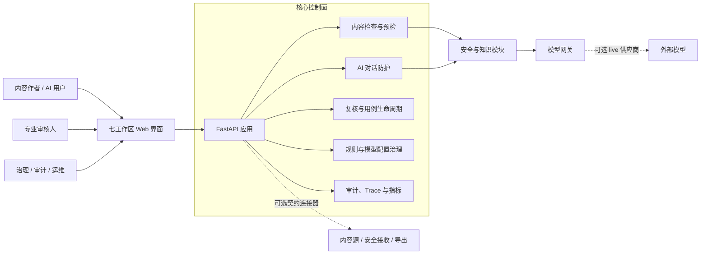
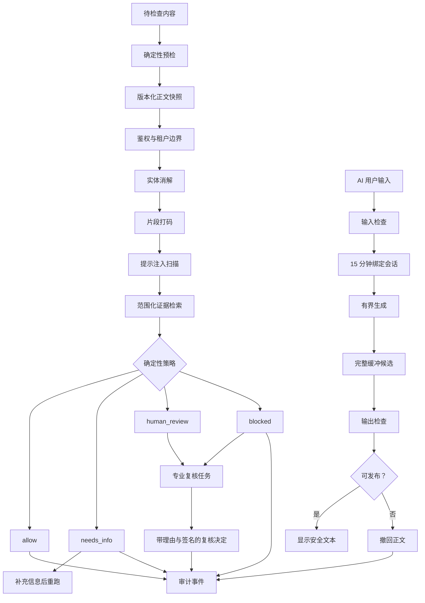
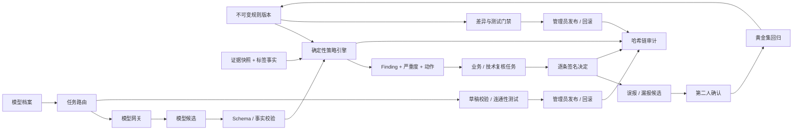
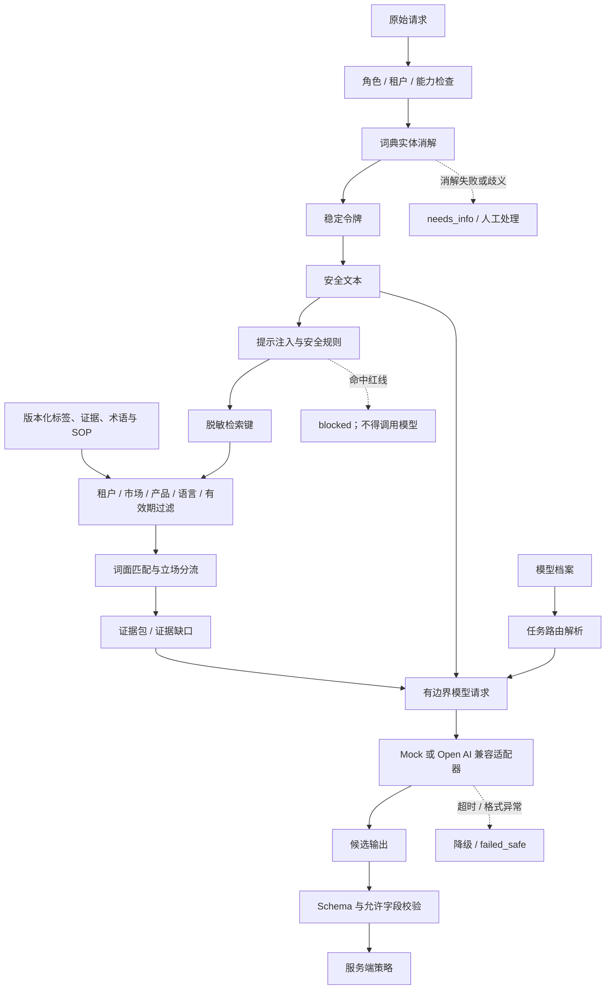
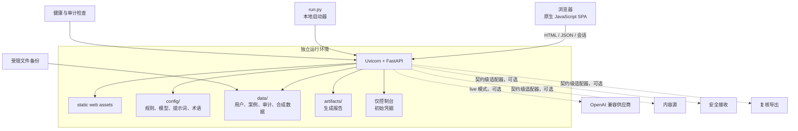

[English](../product-guide.md) · **简体中文**

# Compliance AI Guard 产品手册

本手册面向使用、评估和部署 Compliance AI Guard 的产品用户、合规团队、
运维人员与开发者。它说明产品解决什么问题、七个工作区如何操作、服务如何部署，
以及请求在内容检查、AI 对话、规则、复核和审计模块之间如何流转。

本手册描述当前仓库中已经实现的行为。更深入的实现细节见
[架构设计](architecture.md)、[运维手册](operations.md)、
[安全与风险](security-and-risk.md)、[集成契约](integration-contracts.md)
和[验证文档](validation.md)。交互式系统架构图位于
[产品架构图](../assets/product/system-architecture.html)。

## 1. 产品背景

### 1.1 要解决的问题

医药内容团队在处理客户互动记录、医学信息答复、推广材料和 AI 对话时，会遇到
四类相互关联的问题：

- 风险判断分散在人工审阅、关键词检查、内容系统和 AI 工具中，同一类表述可能
  得到不同结论。
- 大语言模型可以理解语义和起草回复，但无法为严重度、发布权限、复核路由和
  可追溯性提供稳定保证。
- 用户消息、模型输入和模型输出都可能包含个人信息、患者健康信息、提示注入或
  超说明书表达，任何一处漏检都可能造成数据或合规风险。
- 一旦模型、解析器、权限或审计失败，传统“重试后继续”的流程容易把失败误当成
  通过，形成失效开放。

### 1.2 产品定位

Compliance AI Guard 是面向医药内容和 AI 对话的可独立部署合规网关。它可以
在内容保存、发送或发布前检查文本，也可以保护 AI 对话的输入和输出。

它的核心边界是：

> 模型提出候选，服务端确定性策略引擎决定处置、严重度、复核路由和发布权限。

模型负责理解语言、抽取结构化字段和起草候选回复。最终判断由版本化规则、
服务端代码和获授权的复核人完成。模型失败、输出格式异常或审计失败时，内容
保持未发布状态，不会因为故障而放行。

### 1.3 目标用户

| 用户 | 主要任务 |
| --- | --- |
| 内容作者、现场代表、提交人 | 编写内容、预检、提交、补充信息、查看结论和申诉 |
| 医学、药物警戒、安全、法务、合规审核人 | 查看证据和 finding，逐条记录带理由的复核决定 |
| 合规管理员 | 管理规则、复核升级、模型配置发布与回滚 |
| 架构与平台人员 | 维护身份、部署、模型路由、连接器、健康和存储 |
| QA、审计、法规事务 | 校验审计链、监督指标、回归候选和接口治理证据 |
| 集成开发者 | 使用 HTTP API 把检查、会话防护和审计能力接入现有流程 |

### 1.4 适用边界

本仓库提供可运行的合成数据演示、控制逻辑和验证基础。它不包含真实客户内容、
生产连接器、企业身份提供商或法规认证。`allow` 表示当前规则版本没有发现需要
阻止的问题，不表示法律、医学或监管批准。

当前实现不声称完成 GxP/CSV 验证、药物警戒体系验证、医学法务法规（MLR）审批
或任何监管认证。部署者仍需根据实际组织、市场、数据分级和适用法规完成系统
验证、隐私评估、身份集成和运维批准。

## 2. 产品原则

### 2.1 工作流优先

系统先执行鉴权、实体消解、打码和提示注入扫描，再决定是否允许模型访问。候选
输出经过 Schema 校验、确定性策略和必要的复核后才能发布。模型没有直接发布
权限。

### 2.2 版本绑定

检查结果绑定精确的正文版本、规则版本、知识快照、模型路由和相关审计事件。
正文被修改后，旧结果的片段位置不再可信，必须重新检查。规则版本变化后，已有
AI 会话也不能继续生成。

### 2.3 失败安全

模型超时、工具失败、输出格式异常、打码失败、权限拒绝或审计写入失败都会保持
阻断、降级或人工处理状态。`MANUAL_DEGRADED`、`FAILED_RETRYABLE` 和
`FAILED_SAFE` 都不会转为 `ALLOWED`。

### 2.4 最小权限与职责分离

提交、业务复核、技术复核、审计导出、配置发布和配置回滚使用独立能力。客户端
隐藏不可用控件只是界面辅助；每个受保护 API 都独立检查操作者、角色和租户。

### 2.5 隐私默认最小化

外部模型只接收有边界的请求。识别出的个人或健康信息片段在调用前替换为稳定
令牌，原文不发送给外部模型。审计载荷保存标识、版本、摘要、处置和聚合指标，
默认不保存原文、令牌映射、系统提示或完整模型输出。

## 3. 快速启动

### 3.1 环境要求

- Python 3.12 或更高版本；仓库已在 Python 3.13 上验证。
- 独立模式使用 Python 标准库的本地 JSON/JSONL 存储，不需要外部数据库、
  消息队列、身份提供商或在线模型。
- 使用浏览器访问单页界面，前端不需要 Node.js 构建链。

### 3.2 安装并运行演示模式

```bash
python3 -m venv .venv
.venv/bin/python -m pip install -e ".[test]"
LLM_MODE=mock DEMO_MODE=1 PYTHONPATH=src \
  .venv/bin/python -m uvicorn apps.api.main:app \
  --host 127.0.0.1 --port 8000
```

打开 <http://127.0.0.1:8000>。`DEMO_MODE=1` 跳过登录，并提供 `author`、
`reviewer`、`auditor` 和 `architect` 四个演示角色。演示角色来自请求头或界面
选择，不构成生产身份认证。

也可以使用一键启动：

```bash
LLM_MODE=mock DEMO_MODE=1 python3 run.py
```

该命令选择空闲端口并打开浏览器，适合本地评审。

### 3.3 运行正式会话模式

```bash
LLM_MODE=mock PYTHONPATH=src \
  .venv/bin/python -m uvicorn apps.api.main:app \
  --host 127.0.0.1 --port 8000
```

首次启动会生成临时 `admin` 密码，并只在控制台显示一次。使用该账号登录后必须
立即修改初始密码。修改成功会注销该账号的全部会话，包括当前会话，随后使用新
密码重新登录。

本地身份存储只提供最小会话能力，不提供身份提供商、第二因子或用户管理。正式
投入使用前，应通过组织现有的身份、访问和审计体系替换该边界，并限制
`data/` 目录的访问权限。

### 3.4 检查服务健康

| 端点 | 用途 |
| --- | --- |
| `GET /health/live` | 检查进程是否存活，不探测下游依赖 |
| `GET /health/ready` | 检查配置、依赖、模型凭证路径和 demo/live 状态 |
| `GET /health` | 查看模型模式、知识快照与配置版本摘要 |

`ready` 未通过时应先修复依赖或配置，再接受新的检查与发布操作。

## 4. 身份、角色与权限

### 4.1 演示角色

| 演示角色 | 可做操作 |
| --- | --- |
| `author` | 提交内容、检查 AI 输入、查看自己的结果 |
| `reviewer` | 打开业务复核任务、查看证据并记录决定 |
| `auditor` | 查看审计证据、质量态势和连接器 |
| `architect` | 查看和起草模型配置，不能发布或回滚 |

### 4.2 权限模型

服务端权限矩阵还支持提交人、现场代表、药物警戒、医学、安全、法务、合规、
QA、法规事务、MLR 审核、QPPV、安全管理员和系统角色。实际可见能力由服务端
`GET /api/permissions` 返回的能力矩阵决定。

主要职责分离如下：

| 能力 | 典型角色 | 控制目的 |
| --- | --- | --- |
| `submit` | 作者、提交人、代表、管理员 | 允许创建正式检查 |
| `review_case` | 业务审核、医学、合规、QPPV、MLR | 审核可处理的业务任务 |
| `audit_export` | 审计、安全、QA、法规事务、合规管理员 | 防止审计证据被普通业务角色读取 |
| `architecture_review` | 架构师、合规管理员 | 查看和起草模型配置 |
| `config_publish` | 合规管理员、管理员 | 发布版本化规则或模型配置 |
| `config_rollback` | 合规管理员、管理员 | 恢复稳定配置版本 |

租户隔离在能力检查之外执行。客户端不能通过修改界面状态获得额外权限，也不能
通过亮度、按钮状态或已返回的成功标志把旧结果复用于新文本。

### 4.3 登录接口

正式会话模式支持以下端点：

- `POST /api/auth/login`
- `GET /api/auth/me`
- `POST /api/auth/change-password`
- `POST /api/auth/logout`

登录成功后浏览器持有 HttpOnly 会话 cookie。`x-demo-role` 请求头只在
`DEMO_MODE=1` 时有效，不能作为正式部署的认证机制。

## 5. 界面约定与状态语义

### 5.1 七个工作区

界面按固定顺序提供七个工作区，可使用数字键 `1` 至 `7` 切换。焦点位于输入框、
文本域、下拉框或可编辑控件时，数字快捷键不会触发。

1. `overview`
2. `content_check`
3. `conversation_guard`
4. `reviews`
5. `rules`
6. `quality_audit`
7. `settings`

界面右上角可切换中文与英文。切换语言不会清除正在编辑的内容，也不会改变服务端
状态。

### 5.2 四种公共处置

| 处置 | 含义 | 用户下一步 |
| --- | --- | --- |
| `allow` | 当前规则未发现需要阻止的问题 | 可按当前版本继续保存、发送或发布 |
| `needs_info` | 缺少证据或业务上下文 | 补齐字段或证据后重新提交 |
| `human_review` | 需要专业人员评估 | 等待指定角色查看证据并作决定 |
| `blocked` | 当前条件下禁止继续 | 按整改建议修改、提交申诉或升级处理 |

`refused` 是内部安全终态，表示请求无法按安全方式处理，不对应普通业务放行。

### 5.3 严重度

| 级别 | 含义 | 处理规则 |
| --- | --- | --- |
| S0 | 红线问题，例如严重安全事件、严重数据泄露、提示注入或不可逆写入 | 立即阻断或升级；不允许自我批准 |
| S1 | 高风险问题，例如潜在不良事件、超说明书表达、证据冲突 | 必须由相应专业角色复核；不允许自我批准 |
| S2 | 缺少信息或上下文 | 补充后重跑检查；低风险复核任务可批量处理 |
| S3 | 低风险措辞或格式提示 | 可按建议调整；低风险复核任务可批量处理 |

严重度描述的是当前规则发现的风险，不是对人员、产品、品牌或组织行为的法律定性。

### 5.4 草稿与恢复

总览和独立内容检查会保留本地草稿。重新进入页面时，系统展示“发现未提交草稿”
提示，只有用户主动选择“恢复草稿”才会覆盖当前编辑区，避免静默数据丢失。
`Cmd/Ctrl + Enter` 可提交总览中的业务记录检查。

## 6. 各功能详细使用说明

### 6.1 总览：业务记录检查

总览工作区用于检查带业务上下文的客户互动记录、医学信息请求等内容。

1. 选择来源系统与上游记录；如有连接器，可读取指定版本的上游内容。
2. 核对产品、市场、渠道和内容语言。这些字段决定证据检索与规则作用域。
3. 需要引用图片或音频时，添加附件引用。当前接口只登记文件名、MIME 类型、
   大小和引用元数据，不接收或保存二进制文件。
4. 在正文区域编写或粘贴内容。编辑期间可出现本地词面提示和服务端确定性预检；
   预检不创建案例、不保存正文、不调用模型。
5. 点击“提交并完成合规检查”。正式提交会建立版本化检查，在配置允许时调用
   有界模型抽取，并返回处置、严重度、finding、片段、证据和版本信息。
6. 查看“安全视图（已脱敏）”、风险发现、后续动作、引用证据和审计链路。
   页面会机器代码与易读标签并列显示，便于审计时引用。

结果中的 Unicode 字符区间只对应提交时的正文。正文改动后重新检查，不要沿用
旧高亮或旧成功状态。

若返回 `needs_info`，使用补充信息表单提供缺少的字段。若显示可接受的重写建议，
该建议已经过第二次确定性检查；只有用户主动点击替换才会修改正文。若需要基于
当前稿件修改，使用“基于本稿修订后重新提交”创建新案例，原案例和原判断继续
保留。

### 6.2 独立内容检查

独立内容检查适合提交不属于具体客户互动记录的推广文案、医学信息答复或其他
文本。

1. 在左侧选择内容类型。
2. 沿用总览中的市场、语言与产品上下文。
3. 输入待检查正文并点击“检查内容”。
4. 查看检查编号、规则版本、内容版本、流程状态、finding 列表和可选片段高亮。
5. 修改正文后，点击出现的“正文已变化，重新检查”。

检查结果只适用于该次正文快照。即使两次提交文本相似，也应使用最近一次服务端
返回的检查编号、正文版本和规则版本进行后续引用。

### 6.3 AI 对话防护

AI 对话防护分为输入、生成和输出三个独立阶段。只有输入检查通过了允许条件才
建立会话；只有输出检查允许后才显示模型正文。

#### 第一阶段：检查输入

1. 输入要发送给 AI 的消息。
2. 点击“检查并建立会话”。
3. 服务端执行鉴权、实体消解、打码、提示注入扫描和输入规则。
4. 输入被阻断时，不创建会话，也不调用模型。
5. 通过时返回 `conversation_id`，并建立 15 分钟服务端会话。

会话绑定操作者、租户、已检查输入哈希、规则版本和失效时间。安全输入保存在
服务端；客户端不能新增、改写或替换模型实际收到的输入。

#### 第二阶段：生成候选

1. 点击“生成安全回复”。
2. 请求必须携带输入检查时的同一份正文。文本不一致返回
   `conversation_prompt_mismatch`。
3. 规则版本变化返回 `conversation_requires_recheck`。
4. 会话过期或关闭返回 `conversation_expired`。
5. 生成资格是一次性消费；相同会话不能重复换取新的发布许可。

模型只收到服务端保存的安全输入、任务约束和必要证据，不能设置 final decision、
严重度、复核路由或工具权限。

#### 第三阶段：检查并显示输出

完整候选回复会先被缓冲并经过共享规则和输出专用规则。只有总处置为 `allow` 且
所有 finding 都允许发布时才显示。被阻断的输出会撤回，不显示模型正文，只保留
安全状态和 finding。

如果生成或输出检查无法安全完成，接口返回 `failed_safe`，HTTP 状态为 503。
此时不要重试旧会话或拼接未检查的模型输出；应重新开始输入检查。

### 6.4 专业审核

专业审核工作区处理需要人工判断的业务任务。

1. 打开待审队列。默认只显示医学、安全、合规等业务任务。
2. 选择任务，查看案例处置、流程状态、规则版本、安全引用、finding、证据、
   模型路由、知识快照和审计时间线。
3. 选择判定：接受放行、驳回阻断、升级转人工复核或退回补充信息。
4. 填写必填理由。理由会进入复核记录和审计事件。
5. 提交判定，并在界面核对本次签名表现形式。

S0 和 S1 任务不能选择“接受（放行）”，不能自我批准，也不能批量处理。只有
S2 和 S3 可批量处理，批量操作仍要求统一理由。签名与判定内容、理由、任务和
操作者绑定。

平台安全和配置治理任务默认不出现在业务复核队列，但不会被删除。授权角色可
通过 `GET /api/reviews?scope=all` 查看全部任务；复核队列的筛选不改变底层
处置、finding、任务或审计记录。

审核人可通过“这条判断有问题？”标记误报或漏报。候选用例需要另一位有权限的
同事确认后才会进入黄金集，防止一个人单独改变后续发布门禁。

### 6.5 规则

规则工作区展示当前生效规则、规则编号、finding 类型、最高严重度、处置和版本
历史。它主要是一个查看入口。

受控规则生命周期通过 API 提供：

1. 查看当前版本与历史：`GET /api/rules`。
2. 测试单条规则：`POST /api/rules/test`。
3. 批量或黄金集评估：`POST /api/rules/evaluate`。
4. 比较版本：`GET /api/rules/diff?before=...&after=...`。
5. 通过测试门禁后发布：`POST /api/rules/publish`。
6. 恢复不可变的历史版本：`POST /api/rules/rollback`。

规则包发布后不可变。规则版本变化不会改写历史检查；历史结果保留产生它的策略
版本，基于旧版本的 AI 会话必须重新完成输入检查。

### 6.6 质量与审计

该工作区面向 QA、审计、安全、法规事务和合规管理员。

1. 查看审计链完整性。正常应返回 `ok: true`；失败时关注
   `first_broken_seq` 与原因，暂停新的发布，保留现场并调查。
2. 查看人工监督健康度。过低的推翻率可能是自动化偏见的预警；复核完成率下降
   可能表示队列拥堵。两者应结合案例证据判断。
3. 查看待确认的误报/漏报回归候选，由另一位有权限的同事确认。
4. 查看 `ALCOA+` 数据完整性说明、接口治理清单和追加写入的审计事件。
5. 需要独立验证时调用 `GET /api/audit-trail/verify` 和
   `GET /api/audit-trail`。

审计记录包含执行主体、案例或 trace 标识、时间、状态迁移、规则与配置版本、
处置、安全摘要和失败类别。默认不包含原文、敏感实体值、token 映射、系统提示
或完整模型输出。审计内容访问与导出需要 `audit_export` 能力。

### 6.7 设置：模型档案与任务路由

设置工作区管理模型档案、任务路由和版本化发布配置。

1. 点击“刷新”查看当前发布版本、模型档案、任务路由、凭据引用、能力、数据
   分级、区域、超时、令牌预算和失败转人工策略。
2. 使用 `PUT /api/config/models` 暂存档案与路由草稿；界面通过“保存草稿”触发
   相应配置流程。
3. 页面显示草稿差异与校验消息。
4. 选择测试任务并执行连通性测试。Mock 模式使用离线 fixture；live 模式需要
   已配置的供应商凭证与 endpoint 映射。
5. 经授权的管理员核对差异后点击“发布”，或点击“回滚”恢复稳定版本。

凭据只以引用形式保存在配置中，读取时打码。真实密钥应放在环境变量或被
gitignore 的本地文件中，不能写入提交内容、审计记录或页面。

模型 provider 的 live 模式尚未在客户环境中完成验证。正式启用前应独立验证
供应商数据驻留、凭证轮换、超时、限流、输出 Schema、故障转人工和成本。

## 7. 端到端用户旅程

### 7.1 内容作者的典型流程

1. 在总览选择上下文并编写业务内容。
2. 使用本地提示与确定性预检提前发现问题。
3. 正式提交，获得 `allow`、`needs_info`、`human_review` 或 `blocked`。
4. 对 `needs_info` 补充信息；对可修订内容基于原稿建立新检查。
5. 对 `human_review` 等待专业决定，并在通知中查看结论。
6. 对 `blocked` 按整改方向修改、提交申诉或升级；申诉不会立即解除阻断。

### 7.2 审核人的典型流程

1. 打开业务复核队列，优先查看已超过 SLA 的任务。
2. 核对安全引用、原文 finding、证据版本与系统处置。
3. 逐条填写理由并提交判定，检查签名表现形式。
4. 对误报或漏报生成候选回归用例，等待第二人确认。
5. 对 S0/S1 做明确升级或阻断，不通过批量操作降低监督强度。

### 7.3 治理与运维的典型流程

1. 检查 `/health/ready` 和配置版本。
2. 查看规则历史和模型路由，先在草稿或测试版本完成验证。
3. 发布前检查差异、黄金集结果、审计链状态和回归候选。
4. 由有权限的管理员发布或回滚，并确认审计事件已写入。
5. 定期核对复核 SLA、推翻率、完成率、模型失败分类和存储留存策略。

## 8. API 快速示例

### 8.1 持久化内容检查

在演示模式中可直接提交；正式模式使用会话 cookie。

```bash
curl -X POST http://127.0.0.1:8000/api/checks \
  -H 'Content-Type: application/json' \
  -d '{
    "tenant_id": "TENANT-CN",
    "market": "CN",
    "language": "zh-CN",
    "product_id": "PRODUCT-001",
    "content_type": "customer_interaction_note",
    "content": "患者服药后出现皮疹。"
  }'
```

响应应被视为一个版本化案例。不要只依赖 HTTP 成功状态；应读取 `decision`、
`severity`、`findings`、`policy_version` 和 `content_version`。

### 8.2 AI 输入检查与生成

演示模式：

```bash
curl -X POST http://127.0.0.1:8000/api/conversations/guard-input \
  -H 'Content-Type: application/json' \
  -H 'x-demo-role: field_rep' \
  -d '{
    "tenant_id": "TENANT-A",
    "content": "请概述成人高血压用药时需要注意的安全信息。",
    "language": "zh-CN",
    "market": "CN",
    "product_id": "PRODUCT-A"
  }'
```

从响应保存 `conversation_id`，再提交与输入检查完全相同的正文：

```bash
curl -X POST \
  http://127.0.0.1:8000/api/conversations/<conversation_id>/generate \
  -H 'Content-Type: application/json' \
  -H 'x-demo-role: field_rep' \
  -d '{
    "tenant_id": "TENANT-A",
    "content": "请概述成人高血压用药时需要注意的安全信息。"
  }'
```

正式部署去掉 `x-demo-role`，使用登录产生的 HttpOnly 会话 cookie。

### 8.3 主要端点索引

| 能力 | 端点 |
| --- | --- |
| 快速预检 | `POST /api/checks/precheck` |
| 持久化内容检查 | `POST /api/checks` |
| 前端兼容检查入口 | `POST /api/cases/check` |
| 前端兼容预检入口 | `POST /api/cases/precheck` |
| AI 输入检查 | `POST /api/conversations/guard-input` |
| AI 生成 | `POST /api/conversations/{id}/generate` |
| 案例列表与详情 | `GET /api/cases`、`GET /api/cases/{case_id}` |
| 修订与补充 | `POST /api/cases/{case_id}/revise`、`POST /api/cases/{case_id}/followup` |
| 申诉 | `POST /api/cases/{case_id}/appeal`、`GET /api/appeals` |
| 复核队列与决定 | `GET /api/reviews`、`POST /api/reviews/{task_id}/decision` |
| 审计轨迹 | `GET /api/audit-trail`、`GET /api/audit-trail/verify` |
| 指标 | `GET /api/metrics` |
| 权限矩阵 | `GET /api/permissions` |
| 连接器与来源 | `GET /api/connectors`、`GET /api/sources` |
| 模型配置 | `GET/PUT /api/config/models`、`POST /api/config/publish` |

集成方应使用 `/api/checks` 作为正式内容检查入口。`/api/cases/check` 与
`/api/cases/precheck` 是现有前端使用的兼容入口。发布端应检查 `decision`
和逐条 finding 的允许动作，而不是仅凭案例创建成功就假定可以发布。

## 9. 系统架构

Compliance AI Guard 是单体 FastAPI 服务加原生浏览器界面的独立系统。各模块
通过共享领域契约协作；不要求数据库、队列或消息总线。外部模型和连接器都是
可选替换接缝。

### 9.1 系统上下文与容器



界面的七个工作区只是同一控制面的不同入口。内容检查和对话防护共享规则、
finding、复核与审计语义。规则或模型配置变化不会形成两个互不相关的检查栈。

### 9.2 内容检查与 AI 对话链路



有两个顺序不能交换：实体消解必须先于打码，以免同一身份被拆成多个令牌；提示
注入扫描必须先于任何模型访问。AI 输出必须完整缓冲后检查，不能先流式展示再补救。

### 9.3 规则、复核、审计与模型治理



规则包、模型配置和复核决定都是可追溯的业务事实。发布或回滚与审计写入失败时，
应保持发布暂停状态。

### 9.4 安全、知识与模型网关模块



打码只替换识别出的实体片段，不重写整段业务叙述。打码不足可能泄露标识符，
打码过度可能删除判断语境；两种失败都不能成为发布许可。没有证据会形成明确
证据缺口，不能默默放行。

### 9.5 部署、存储与可选连接器



独立模式把状态写入本地 JSON/JSONL。`data/`、`artifacts/` 和本地密钥文件不能
提交到仓库。真实部署需要为存储权限、加密、备份、留存和恢复建立组织流程；
仓库本身不提供生产数据库或密钥管理服务。

## 10. 数据、安全与失败处理

### 10.1 数据最小化

- 预检不创建案例、不保存提交正文、不调用模型。
- 外部模型只接收已打码的安全文本、必要证据和受约束上下文。
- 审计默认只写摘要、标识、版本、状态和聚合指标，不写完整正文或模型回复。
- 附件端点只保存引用元数据，不保存二进制文件。

### 10.2 审计完整性

审计账本为只追加哈希链。每条记录包含前一条记录的哈希、规范化安全载荷和摘要。
`GET /api/audit-trail/verify` 返回首条无法验证的位置、原因、已检查数量和链头
哈希。链存在前写入的历史条目会单独报告，不能被声称已被链覆盖。

审计导出、审计校验和发布权限分开授权。发生 `ok: false` 时，应暂停新的发布，
保留账本与运行证据，调查写盘、权限、导入或人为修改。

### 10.3 失败与重试

| 情况 | 期望状态 | 操作 |
| --- | --- | --- |
| 短期依赖错误 | `FAILED_RETRYABLE` | 在有界预算内重试，耗尽后人工接管 |
| 模型超时或候选格式异常 | `MANUAL_DEGRADED` | 保持未发布，按当前策略和路由重试或人工处理 |
| 打码、权限、审计或无法安全处理的失败 | `FAILED_SAFE` | 不放行，保留安全错误并升级 |
| 会话正文不一致 | `conversation_prompt_mismatch` | 重新做输入检查，不复用旧会话 |
| 规则版本已变化 | `conversation_requires_recheck` | 按当前规则重新检查输入 |
| 会话过期 | `conversation_expired` | 重新建立 15 分钟会话 |

任何错误处理都不能修改历史决定或把降级状态写成放行。

## 11. 连接器与集成

仓库包含内容源、安全接收和复核导出的契约级适配器，用于展示版本、幂等、健康
状态、重试和死信处理。它们使用内存或合成数据，不是真实客户系统连接器。

集成时应注意：

- 上游记录需要版本号；过期或冲突版本不能被静默信任。
- 事件处理需要幂等键和有界重试，失败事件进入可检查的死信路径。
- 连接器只有在声明的数据分级、动作和区域允许时才能参与发布判断。
- 缺少连接器不会阻断核心检查、规则、复核和审计；可选择人工上传或直接 API。
- `POST /api/attachments` 只返回 `image_ref` 或 `audio_ref` 元数据引用，不存
  文件内容，因此不能把它当作已实现的多模态文件托管服务。

## 12. 验证与试点判断

仓库当前验证入口为 `release_gate`。发布门禁要求综合评估通过，包含 44 条
黄金集和 12 条实体/打码测试。详细结果和复现方法见
[验证文档](validation.md)。

评估产品是否适合试点时，建议同时观察以下指标，而不是只看拦截数量：

| 指标 | 观察目的 |
| --- | --- |
| 黄金集通过率和风险类别召回 | 规则是否能识别目标风险 |
| 好内容误报率与推翻率 | 审核是否被迫绕过系统 |
| 复核完成率与 SLA 超期数 | 人工流程是否实际可运行 |
| 第二人确认的回归候选数量 | 反馈闭环是否在改善规则 |
| 模型失败、降级和 `failed_safe` 比例 | 依赖稳定性是否影响流程 |
| 审计链验证结果 | 证据是否持续完整 |
| 会话重新检查比例 | 版本绑定是否造成可用性问题 |

这些指标需要与组织确认的目标阈值结合使用。仓库不提供真实客户基线，也不应把
合成数据的通过结果外推为生产准确性证明。

## 13. 当前限制与上线前检查

当前已知限制：

- 独立存储为本地 JSON/JSONL，不是高可用数据库或分布式队列。
- 本地身份仅提供密码会话，不提供企业 SSO、多因素或用户管理。
- 连接器为契约级模拟接口，没有真实客户系统连接。
- Mock 模式用于开发、演示和自动测试；live 模型供应商尚未完成客户环境验证。
- 规则 UI 目前主要查看当前规则和历史，完整生命周期通过受控 API 操作。
- 不声称完成 GxP/CSV、药物警戒、MLR、隐私或监管认证。

正式上线前至少需要确认：租户与身份模型、数据驻留、存储加密与备份、密钥轮换、
日志留存、连接器验证、供应商 SLA、应急人工流程、规则 owner、复核 SLA 和
审计导出权限。

## 14. 现有文档索引

| 文档 | 内容 |
| --- | --- |
| [架构设计](architecture.md) | 共享控制面、请求路径、策略规则、数据模型和失败状态 |
| [运维手册](operations.md) | 安装、工作区、规则与模型生命周期、真实模式、故障处置 |
| [安全与风险](security-and-risk.md) | 威胁模型、安全控制、失败语义和风险边界 |
| [验证文档](validation.md) | 发布门禁、黄金集、实体检查和复现方法 |
| [集成契约](integration-contracts.md) | 内容源、安全接收和复核导出接口 |
| [架构决策](decisions/0001-workflow-first-controlled-agent.md) | 为什么采用工作流优先、模型候选化的设计 |
| [English product guide](../product-guide.md) | 本手册的英文版本 |
